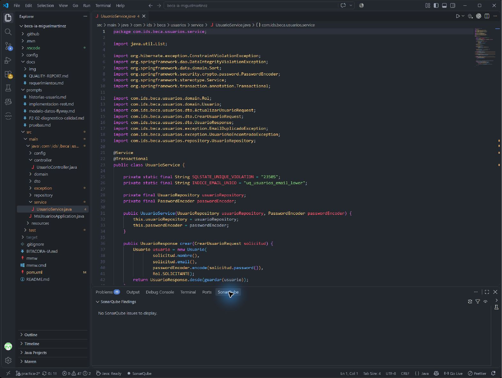
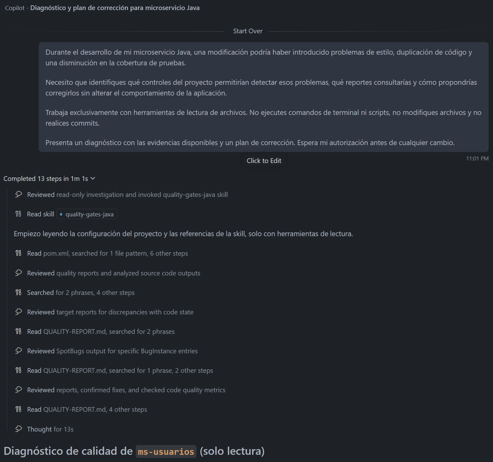
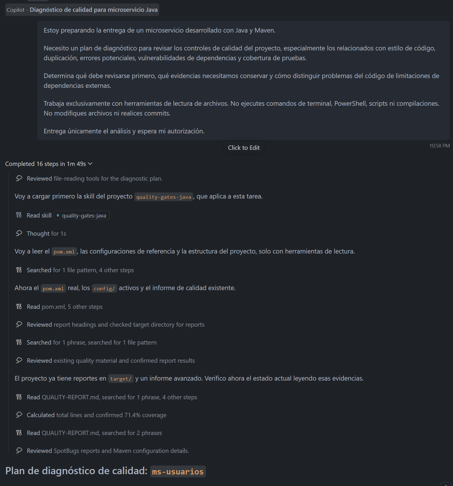

# Reporte de calidad — `ms-usuarios`

**Práctica:** P2 — Calidad como código con instrucciones y skills
**Fecha de línea base:** 06/11/2026
Última actualización documental: 09/11/2026 (hora de Ciudad de México, UTC−06:00; cierre local y CI del PR #5)
Rama de trabajo: practica-2
Actualización documental P3: véase la sección 12. Los apartados 12.1 a 12.5 conservan la evidencia histórica de P3-05 y P3-06. El apartado 12.6 documenta el cierre técnico de P3-08 y la verificación integral del 12/11/2026.
Alcance: Java 21, Spring Boot 3.5.16, Maven y análisis de calidad de ms-usuarios.

Estado ejecutivo: El 09/11/2026 a las 19:02:34 (UTC−06:00), la ejecución local mvnw.cmd -B clean verify concluyó con BUILD SUCCESS, 18 pruebas aprobadas, 0 fallos, 0 errores y 0 omitidas, y el gate de JaCoCo satisfecho. El reporte local de JaCoCo mostró 77.78 % de cobertura de líneas (98/126); también indicó 75 % de instrucciones (402/530) y 46 % de ramas (15/32). GitHub Actions validó el commit 62fbd69 de practica-2 con `./mvnw -B verify`. Se registraron 18 pruebas aprobadas, Checkstyle con 0 violaciones, SpotBugs sin incidencias y BUILD SUCCESS (CI #42733267317). El CI confirma que JaCoCo superó el mínimo de 70 %, pero no publica el porcentaje exacto; esa cifra se obtuvo del reporte local y la captura compartida durante la revisión, no archivada en GitHub.

**Advertencia de seguridad:** el resultado de OWASP **no implica ausencia de vulnerabilidades**. En el análisis local del 09/11/2026 permanecen **23 CVE detectados: 8 activos con CVSS inferior a 7 y 15 suprimidos**. De las supresiones, 5 corresponden a asociaciones incorrectas de componentes y 10 a **aceptaciones temporales de riesgo** que vencen el 06/12/2026; estas diez CVE **no están corregidas**. Al retirarlas en una prueba controlada, OWASP terminó en `BUILD FAILURE` por CVSS de 7.5 a 9.8. Se restauró el archivo original después de la prueba. Las decisiones y la evidencia figuran en las secciones 6.4, 6.8 y 6.9.
Lectura de resultados: el estado actual es 18 pruebas aprobadas y 77.78 % de cobertura de líneas (medición local del 09/11/2026). El CI posterior al commit también aprobó las 18 pruebas (run #42733267317). Las cifras de 13 pruebas/71.43 % (06/11) y 16 pruebas/70.15 % (07/11) se conservan exclusivamente como historial. La cobertura exacta del runner de GitHub Actions no se dispone en el log.

## Procedencia de la evidencia

El reporte combina la línea base del 06/11, una ejecución local ampliada del 07/11, el diagnóstico de OWASP del 09/11 y el cierre local y de CI del 09/11. La captura local de JaCoCo se revisó durante el cierre de las pruebas. Los valores de cobertura están transcritos en la sección 10.5; no se incluye ningún enlace a un archivo de imagen inexistente. Los reportes de target/ pueden sobrescribirse en futuras ejecuciones, mientras que los logs de CI permanecen disponibles en GitHub.

## 1. Objetivo y alcance

**Objetivo:** establecer la línea base de calidad de `ms-usuarios` antes de corregir hallazgos, documentar con evidencia los resultados antes y después de cada corrección, y consolidar el estado final de la práctica.

**Alcance:**

- Código Java de `src/main/java` y pruebas de `src/test/java`.
- Dependencias del proyecto (Maven, Spring Boot 3.5.16).
- Reglas definidas en `.github/copilot-instructions.md` y en la skill `.github/skills/quality-gates-java/SKILL.md`.
**Fuera de alcance:**

- JWT y autorización por roles (corresponden a P3).
- Migración a Spring Boot 4 / Spring Framework 7 (descartada en esta práctica; ver §6.9).
- Incorporar versiones comerciales Enterprise de Spring sin disponer de soporte o credenciales; se registran como alternativa no aplicada, no como corrección realizada.
**Nota histórica:** la versión de la línea base declaraba como fuera de alcance «correcciones de código y actualizaciones de dependencias (no aplicadas)». Esa afirmación era válida el 06/11/2026 en el diagnóstico inicial; los lotes aplicados después se documentan en la sección 7.3.

## 2. Herramientas utilizadas y versiones

Versiones tomadas de `pom.xml` y de los encabezados de los reportes.

| Herramienta | Plugin / versión | Motor o dato adicional | Configuración |
| --- | --- | --- | --- |
| Checkstyle | `maven-checkstyle-plugin` 3.6.0 | Checkstyle 10.21.4 | `config/checkstyle/checkstyle.xml`; fase `validate`; `failOnViolation=true`; severidad `warning` |
| PMD | `maven-pmd-plugin` 3.26.0 | PMD 7.7.0 (reporte) | `config/pmd/ruleset.xml` |
| CPD | `maven-pmd-plugin` 3.26.0 (`cpd-check`) | PMD 7.7.0 (reporte) | `minimumTokens=80` |
| SpotBugs | `spotbugs-maven-plugin` 4.9.3.0 | SpotBugs 4.9.3 (reporte) | `effort=Max`, `threshold=Medium` |
| FindSecBugs | `findsecbugs-plugin` 1.14.0 | Plugin de SpotBugs | Referenciado en el reporte de SpotBugs |
| OWASP Dependency-Check | `dependency-check-maven` **13.0.0** (línea base: 12.1.0) | Versión 13.0.0 (reporte JSON actual) | `failBuildOnCVSS=7`; clave NVD desde `NVD_API_KEY`; formatos HTML y JSON; sin `ossIndexServerId` |
| JaCoCo | `jacoco-maven-plugin` 0.8.13 | — | Límite BUNDLE, contador LINE, mínimo 0.70 |
| JUnit 5 / Mockito / MockMvc | Spring Boot 3.5.16 (BOM) | Java 21 | Reportes en `target/surefire-reports` |
| SonarQube for IDE | Extensión de VS Code, versión 6.2.0 | Análisis del archivo abierto; no hay evidencia de modo conectado a un servidor **(pendiente de comprobación)** | Evidencia limitada a `UsuarioService.java` (sección 10.1); no hay análisis de todo el proyecto |

**Reglas de Checkstyle activas:** `LineLength` (120), `UnusedImports`, `MagicNumber`, `MultipleStringLiterals`, `CyclomaticComplexity` (10), `MethodLength` (30), `ParameterNumber` (5), `EmptyCatchBlock`, `NeedBraces`.

**Verificación del 07/11/2026:** Maven 3.10.0 mediante el Wrapper y Java 21.0.13. Las versiones de las ejecuciones históricas quedan pendientes.

## 3. Comparación antes y después

La columna «Antes» describe la línea base del 06/11/2026. La columna «Estado más reciente» resume la ejecución local y el CI #42733267317 del 09/11/2026 (UTC−06:00), que confirmaron 18 pruebas exitosas y los quality gates de Maven.

| Herramienta o control | Antes (06/11, línea base) | Estado más reciente y evidencia | Evaluación |
| --- | --- | --- | --- |
| Checkstyle | 19 violaciones: 8 `MagicNumber`, 7 `LineLength`, 4 `MultipleStringLiterals` | 0 violaciones; CI 09/11 confirmó el paso de `checkstyle:check` | Corregido |
| PMD | 0 violaciones | Sin infracciones bloqueantes; CI `verify` exitoso | Cumple |
| CPD | 0 duplicaciones sobre el umbral de 80 tokens | Sin duplicaciones bloqueantes; CI `verify` exitoso | Cumple |
| SpotBugs / FindSecBugs | 0 incidencias | Control superado en CI | Cumple |
| JaCoCo — líneas (umbral ≥ 70 %) | 71.77 % (89/124) | 77.78 % (98/126) en reporte local del 09/11; anteriormente 70.15 % (94/134) el 07/11 (dato de una ejecución previa); gate aprobado en el CI final | Supera el umbral por 7.78 puntos; CI confirma el gate, no el porcentaje |
| JaCoCo — instrucciones y ramas | 68.3 % de instrucciones; 34.4 % de ramas | Reporte local 09/11: 75 % de instrucciones (402/530), 46 % de ramas (15/32) | Informativo; no son los umbrales exigidos |
| Pruebas automatizadas | 13 aprobadas, 0 fallos | 18 aprobadas, 0 fallos, 0 errores y 0 omitidas tanto en Surefire local como en CI #42733267317 | Verificado localmente y en CI |
| OWASP — dependencias afectadas | 10 dependencias con alertas en Dependency-Check 12.1.0 (71 escaneadas, 49 únicas) | 3 con CVE identificadas en el reporte 13.0.0 del 09/11: `spring-core`, `spring-data-jpa`, `spring-security-crypto` | Hay vulnerabilidades pendientes |
| OWASP — CVE detectados | 70 asociaciones dependencia-CVE en la línea base; no son 70 CVE únicos | **23 CVE detectados**: 8 activos + 15 suprimidos, según JSON del 09/11 | Persisten riesgos |
| OWASP — supresiones | 0 en la línea base | 5 asociaciones de módulo incorrectas + 10 aceptaciones temporales. La ejecución sin estas últimas falló por 10 CVE con CVSS ≥ 7 | Observación del instructor pendiente de aprobación |
| OWASP — gate de Maven | `BUILD FAILURE` antes de gestionar CVE **(dato histórico)** | `BUILD SUCCESS` con 15 supresiones; `BUILD FAILURE` con solo 5, en prueba local del 09/11 **(dato histórico)** | Aprobación condicionada por supresiones |
| SonarQube for IDE | Sin captura al inicio | Captura en `docs/img/sonarqube-usuario-service.jpg`, sobre `UsuarioService.java` | Evidencia del archivo solicitado |
| Integración continua | Sin workflow |.github/workflows/ci.yml; CI #42733267317 exitoso el 09/11 (UTC−06:00) con 18 pruebas y los quality gates activos | Incorporado y verificado |

**Nota histórica:** el 06/11, tras corregir los hallazgos de Checkstyle y antes de ampliar los tests, se registraron **13 pruebas y 71.43 % (90/126 líneas)**. Son resultados intermedios, no el estado final. El histórico de OWASP pasó de 47 a 27 y luego a 23 CVE según las ejecuciones descritas en la sección 6.4, con limitaciones de conservación de sus reportes.

## 4. Resultados iniciales por herramienta

### 4.1 Checkstyle (`target/checkstyle-result.xml`)

19 violaciones en 5 archivos Java:

| Regla | Cantidad | Archivos |
| --- | --- | --- |
| MagicNumber | 8 | `Usuario.java` (3), `CrearUsuarioRequest.java` (3), `ActualizarUsuarioRequest.java` (2) |
| LineLength | 7 | `ApiExceptionHandler.java` (6), `UsuarioController.java` (1) |
| MultipleStringLiterals | 4 | `ApiExceptionHandler.java` |

Las violaciones son de estilo y mantenimiento, no errores de compilación. Como la regla se ejecuta en la fase `validate` con `failOnViolation=true`, bloquea el build antes que el resto de los análisis.

### 4.2 PMD (`target/pmd.xml`)

0 violaciones con las reglas de `config/pmd/ruleset.xml` (código muerto, complejidad, código duro).

### 4.3 CPD (`target/cpd.xml`)

0 duplicaciones con `minimumTokens=80`.

### 4.4 SpotBugs con FindSecBugs (`target/spotbugsXml.xml`)

0 incidencias con umbral `Medium` y esfuerzo `Max`.

### 4.5 JaCoCo (`target/site/jacoco/jacoco.csv`)

| Contador | Cubierto / total | Porcentaje |
| --- | --- | --- |
| Líneas (umbral) | 89 / 124 | **71.77 %** |
| Instrucciones | 362 / 530 | 68.3 % |
| Ramas | 11 / 32 | 34.4 % |

El umbral de 70 % se aplica a líneas. Clases con menor cobertura de líneas: `ApiExceptionHandler` (14/34) y `UsuarioService` (23/35). El margen sobre el umbral es de 1.77 puntos porcentuales.

### 4.6 Pruebas (`target/surefire-reports`)

13 pruebas aprobadas, 0 fallos, 0 errores, 0 omitidas: `UsuarioControllerTest` (8), `UsuarioServiceTest` (3), `CrearUsuarioRequestTest` (1) y `MsUsuariosApplicationTests` (1).

### 4.7 Procedencia y cronología de los resultados

La línea base del 06/11 se tomó de reportes de `target/` producidos durante el diagnóstico inicial. Las correcciones de estilo eliminaron las 19 violaciones de Checkstyle. La ejecución local completa del 06/11 pasó con 13 pruebas y 71.43 % de líneas, pero quedó superada por las tres pruebas negativas incorporadas después.

El 07/11 se ejecutó mvnw.cmd -B verify con H2 para la prueba de contexto, sin PostgreSQL local, y se registraron 16 pruebas y 70.15 % de líneas (94/134). El 09/11, un primer CI aprobó esas 16 pruebas. Después se añadieron dos pruebas de servicio, sin modificar código de producción. La verificación local mvnw.cmd -B clean verify concluyó con 18 pruebas, BUILD SUCCESS y 77.78 % de cobertura de líneas (98/126) el 09/11/2026 a las 19:02:34 (UTC−06:00). El CI posterior #42733267317, sobre el commit 62fbd69, aprobó también las 18 pruebas y el gate de JaCoCo. La diferencia de denominadores (134 frente a 126 líneas) impide atribuir íntegramente el aumento porcentual de 7.63 puntos a las dos pruebas sin comparar los reportes de clases y exclusiones.

### 4.8 Resultados comprobables (cierre local y CI del 09/11/2026)

| Control | Estado | Fuente |
| --- | --- | --- |
| Checkstyle | 0 violaciones | Log del CI final del PR #5 |
| PMD y CPD | Gates aprobados | `mvn verify` en CI |
| SpotBugs / FindSecBugs | Gate aprobado | `mvn verify` en CI |
| Pruebas | 18 aprobadas localmente y en CI: controlador (8), servicio (8), DTO (1), contexto (1); fallos 0, errores 0, omitidas 0 | Surefire local y CI #42733267317 |
| JaCoCo | 77.78 % de líneas (98/126) en medición local 09/11; 75 % de instrucciones (402/530) y 46 % de ramas (15/32). Historial: 70.15 % (94/134) el 07/11 | Contadores locales transcritos en §10.5; gate aprobado en CI #42733267317 |
| OWASP Dependency-Check 13.0.0 | `BUILD SUCCESS` con 15 supresiones en el análisis local del 09/11 a las 17:12:06; `BUILD FAILURE` con solo 5 supresiones a las 17:34:12 | Salidas locales del 09/11, detalle §6.9 **(dato histórico)** |
| CI completo | BUILD SUCCESS, workflow ci-miguel, commit 62fbd69, 18 pruebas | Run #42733267317 |

La composición del reporte OWASP con las supresiones originales del 09/11 era de 23 CVE detectados, distribuidos en 15 suprimidos y 8 activos. Los diez CVE temporalmente aceptados están pendientes de corrección de versión. La prueba con cinco supresiones se hizo localmente; después se restauró el XML original. La captura de JaCoCo del 09/11 no es una nueva auditoría OWASP.

### 4.9 Evidencia histórica del 06/11 y verificación posterior

El 06/11/2026 a las 23:55:49 (UTC−06:00) se registró un `clean verify` satisfactorio **antes de ampliar las pruebas**. Se conserva su extracto para trazabilidad; **no es la última verificación funcional**.

```text
[INFO]
[INFO] --- jacoco:0.8.13:report (report) @ ms-usuarios ---
[INFO] Loading execution data file C:\Users\migue\Documents\Proyectos\MS-Users\beca-ia-miguelmartinez\target\jacoco.exec
[INFO] Analyzed bundle 'ms-usuarios' with 12 classes
[INFO]
[INFO] --- jacoco:0.8.13:check (check) @ ms-usuarios ---
[INFO] Loading execution data file C:\Users\migue\Documents\Proyectos\MS-Users\beca-ia-miguelmartinez\target\jacoco.exec
[INFO] Analyzed bundle 'ms-usuarios' with 12 classes
[INFO] All coverage checks have been met.
[INFO] ------------------------------------------------------------------------
[INFO] BUILD SUCCESS
[INFO] ------------------------------------------------------------------------
[INFO] Total time:  45.008 s
[INFO] Finished at: 2026-11-06T23:55:49-06:00
[INFO] ------------------------------------------------------------------------
```

El 07/11 se verificó la ejecución con H2 (sección 10.3). El 09/11 el log de GitHub Actions comprobó **16 pruebas, 0 fallos, 0 errores y 0 omitidas**, además de `All coverage checks have been met` y `BUILD SUCCESS`. Esta última evidencia está disponible en GitHub sin depender de un extracto de consola local.

## 5. Tres hallazgos de Checkstyle: qué ocurría y cómo se resolvió

### 5.1 Números mágicos en los límites de usuarios (`MagicNumber`)

**Antes:** encontré ocho infracciones en `Usuario.java`, `CrearUsuarioRequest.java` y `ActualizarUsuarioRequest.java`. Los valores 120, 254, 20 y 8 aparecían directamente en anotaciones de persistencia o validación. Aunque los límites eran correctos, no quedaba claro que debían conservar la misma definición que las columnas `VARCHAR` de Flyway V1, lo cual aumentaba el riesgo de introducir inconsistencias al mantener el código.

**Corrección que aprobé:** centralicé las longitudes compartidas en `domain/RestriccionesUsuario.java`: nombre 120, correo 254 y rol 20. El mínimo de ocho caracteres para contraseña quedó como constante privada del DTO correspondiente. Comprobé que los valores no cambiaron y que la migración V1 se mantuvo intacta.

**Resultado:** ocho infracciones eliminadas sin cambiar las reglas de negocio ni el esquema. Las pruebas posteriores siguieron aprobando.

### 5.2 Cadenas repetidas en el manejo de errores (`MultipleStringLiterals`)

**Antes:** `ApiExceptionHandler.java` repetía mensajes y claves del cuerpo de error, como `errors`, `campo`, `mensaje` y «La solicitud contiene datos inválidos.». Esto podía producir respuestas `ProblemDetail` inconsistentes si en una modificación futura se cambiaba solo una aparición.

**Corrección que aprobé:** extraje las cuatro cadenas a constantes privadas de la misma clase. No cambié los textos públicos, las claves JSON ni los códigos HTTP.

**Resultado:** cuatro infracciones eliminadas y el contrato de errores preservado.

### 5.3 Líneas demasiado largas (`LineLength`)

**Antes:** Checkstyle señaló siete líneas que excedían 120 columnas, seis en `ApiExceptionHandler.java` y una en `UsuarioController.java`. Dificultaban leer las llamadas y expresiones completas y hacían fallar el gate de estilo.

**Corrección que aprobé:** dividí las expresiones en varias líneas, manteniendo el mismo orden, argumentos y comportamiento.

**Resultado:** siete infracciones eliminadas. En conjunto, los tres lotes redujeron Checkstyle de **19 a 0 violaciones**. No se modificaron rutas REST ni se desactivaron reglas para conseguirlo.

## 6. Alertas de OWASP y limitaciones del análisis

Las secciones 6.1 a 6.3 conservan la **línea base** con Dependency-Check 12.1.0. Las secciones 6.4 a 6.8 documentan el análisis con 13.0.0 y las decisiones tomadas el 06/11; la sección **6.9** añade la revalidación del 09/11, posterior a la retroalimentación del instructor.

### 6.1 Alertas de dependencias (línea base)

Datos del encabezado de `target/dependency-check-report.html` (Dependency-Check 12.1.0) :

| Concepto | Valor |
| --- | --- |
| Dependencias escaneadas | 71 (49 únicas) |
| Dependencias vulnerables | 10 |
| Vulnerabilidades encontradas (asociaciones dependencia-CVE) | 70 |
| Vulnerabilidades suprimidas | 0 |

Métrica reportada por la consola de OWASP:

| Métrica | Antes | Después |
| --- | --- | --- |
| CVSS máximo reportado | 9.8 **(dato histórico)** | 9.8 (13.0.0; CVE de spring-core en el JSON) |

- Los 70 son asociaciones dependencia-CVE, no CVE únicos. Un mismo CVE puede aparecer asociado a varias dependencias. El número de CVE únicos de la línea base quedó **(pendiente de comprobación)**; las cifras del estado final están en la sección 6.4.
- El CVSS máximo de 9.8 lo proporcionó el desarrollador a partir de la consola de OWASP **(dato histórico)**. En el reporte de Dependency-Check 13.0.0 hay 5 CVE de `spring-core` con CVSS 9.8.
- Una alerta de OWASP indica una coincidencia entre una dependencia y un identificador conocido. **No demuestra que el microservicio sea explotable**, ni siquiera con un CVSS alto. Cada alerta requiere triage: versión realmente afectada, ruta de ejecución y posible falso positivo.
- En el HTML se observan referencias a avisos de seguridad de Spring (`CVE-2026-59314`, `CVE-2026-47834` y `CVE-2026-59276`). No se confirmó la dependencia asociada ni el CVSS de cada una.
- El resultado `BUILD FAILURE` por vulnerabilidades con CVSS ≥ 7.0 es un dato proporcionado por el desarrollador **(dato histórico)**. No hay consola en el repositorio para verificarlo.

### 6.2 Errores de configuración de la herramienta (distintos de las alertas)

| Error | Evidencia | Naturaleza |
| --- | --- | --- |
| HTTP 401 Unauthorized de OSS Index (12.1.0) | en la sección «Analysis Exceptions» del HTML de la línea base (leído el 06/11/2026; el archivo se sobrescribió con el reporte de 13.0.0) | Autenticación del analizador OSS Index de Dependency-Check (Sonatype). No es un problema del código. Es independiente del error de metadatos de Flyway descrito abajo. |
| Advertencia HTTP 401 al obtener metadatos Maven del repositorio `flyway-community-db-support` | **(dato histórico)**: registro de consola proporcionado por el desarrollador el 06/11/2026, todavía no archivado en el repositorio. Comando: `.\mvnw.cmd -B clean verify -Ddependency-check.skip=true`. Mensaje: `[WARNING] Could not transfer metadata /.meta/prefixes.txt from/to flyway-community-db-support (https://maven.pkg.github.com/flyway/flyway-community-db-support): HTTP Status: 401`. No existe evidencia verificable en el repositorio ni en `target/` (el HTML actual no contiene ningún 401); es un registro histórico de consola. | Es una advertencia (`[WARNING]`) de obtención de metadatos Maven; no impidió el `BUILD SUCCESS` de esa ejecución, y Flyway validó correctamente la migración V1 según el mismo registro **(dato histórico)**. No guarda relación con la autenticación de Sonatype OSS Index ni con Dependency-Check. |
| URL demasiado largas al actualizar los datos de Dependency-Check 12.1.0 | **(dato histórico)**; no figura en el HTML | Problema de la herramienta o de su base interna. No es un problema del código. El desarrollador indicó que 12.2.2 corrigió el problema y se actualizó a 13.0.0 (sección 7.3, lote P2-06); no hay salida de consola que confirme la desaparición del error **(pendiente de comprobación)**. |
| OSS Index deshabilitado automáticamente en 13.0.0 por falta de credenciales de Sonatype | **(dato histórico)**; `pom.xml` no declara `ossIndexServerId` | Limitación de configuración: no hay token de Sonatype Guide. Es una condición distinta del HTTP 401 observado en la línea base. |

**Efecto:** con OSS Index deshabilitado, ese analizador no aporta resultados al reporte de 13.0.0. No se ha medido cuánta cobertura se pierde **(pendiente de comprobación)**.

**Decisión sobre OSS Index:** no se autoriza desactivar ese analizador sin evaluar antes las alternativas y las consecuencias para la cobertura del análisis de seguridad. Cualquier cambio adicional en la configuración de OWASP requiere aprobación previa.

### 6.3 Limitaciones de lectura del reporte

- El HTML de la línea base (12.1.0) tiene una línea de unos 387 KB y las herramientas de lectura solo muestran su inicio.
- Las 10 dependencias de la línea base y sus CVE únicos **no se identificaron** **(pendiente de comprobación)**. Desde la versión 13.0.0 existe `target/dependency-check-report.json`, que permite el detalle por dependencia (secciones 6.4 y 6.6).
- Solo se conserva el JSON del último escaneo (23 CVE). Los reportes de los estados de 47 y 27 CVE se sobrescribieron y esas cifras son **(dato histórico)**.

### 6.4 Evolución de las vulnerabilidades detectadas (Dependency-Check 13.0.0)

| Estado | CVE | Dependencias con alertas | Cambio aplicado | Evidencia |
| --- | --- | --- | --- | --- |
| Primer escaneo con 13.0.0 | 47 | 7 | — | **(dato histórico)** |
| Tras `postgresql.version=42.7.14` y `tomcat.version=10.1.61` | 27 | 5 | −20 | **(dato histórico)** |
| Tras `log4j2.version=2.25.5` y `jackson-bom.version=2.21.5` | **23** | 3 | −4 | (`target/dependency-check-report.json` de la ejecución del 06/11/2026) |

Reducción acumulada: 47 → 23 CVE (−24) detectados. Composición del estado de 23 CVE  (anterior a las suppressions, que llevó al `BUILD FAILURE`):

| Dependencia | Versión | CVE | CVSS ≥ 7 | CVSS por CVE |
| --- | --- | --- | --- | --- |
| `spring-core` | 6.2.19 | 17 | 12 | 9.8 (5), 9.1 (1), 7.5 (6), 6.1 (3), 4.3 (1), 3.7 (1) |
| `spring-security-crypto` | 6.5.11 | 5 | 3 | 9.1, 7.4, 7.4, 6.5, 5.9 |
| `spring-data-jpa` | 3.5.13 | 1 | 0 | 6.5 |
| **Total** |  | **23** | **15** |  |

- Dependencias que dejaron de tener alertas: `tomcat-embed-core`, `postgresql`, `log4j-api` y `jackson-databind` (versiones 10.1.61, 42.7.14, 2.25.5 y 2.21.5 en el reporte). La eliminación de sus CVE se limita a lo que el escáner detecta con esas versiones; no es una garantía de ausencia de otros riesgos.
- Los CVSS corresponden a los valores del reporte (NVD). Pueden diferir de la severidad del proveedor.
- **La reducción de 47 a 23 no elimina todos los riesgos de seguridad:** se detectaron 23 alertas, 15 de ellas bloqueantes antes de las suppressions, y OSS Index no está activo.
**Composición de los 23 CVE confirmada en el reporte local del 09/11/2026**  (JSON: 8 entradas `vulnerabilities` y 15 `suppressedVulnerabilities`). La misma distribución ya se había registrado el 06/11. Las tres categorías son distintas y no deben mezclarse:

| Categoría | CVE | Dependencia / módulo en el JSON | CVSS | Tratamiento | Vencimiento |
| --- | --- | --- | --- | --- | --- |
| **Detectados y activos (no bloquean)** | 8: CVE-2026-47883, 47887, 59281, 59280, 59314 (spring-core); CVE-2026-47834 (spring-data-jpa); CVE-2026-47842, 59276 (spring-security-crypto) | `spring-core` 6.2.19 (5), `spring-data-jpa` 3.5.13 (1), `spring-security-crypto` 6.5.11 (2) | 6.1, 6.1, 6.1, 4.3, 3.7 / 6.5 / 6.5, 5.9 (máximo 6.5) | Siguen presentes y sin corregir; quedan bajo el umbral `failBuildOnCVSS=7`. No se validaron individualmente (salvo el caso límite de CVE-2026-59281, sección 6.6) | No aplica |
| **Falsas asociaciones de componente (suprimidas)** | 5: CVE-2026-47888 y 47893 (detectados en `spring-core` 6.2.19), CVE-2026-59270, 41707 y 47841 (`spring-security-crypto` 6.5.11) | Los módulos realmente afectados (`spring-messaging`, `spring-webflux`, `spring-security-ldap`, `spring-security-oauth2-jose`, `spring-security-web`) no están en el árbol de dependencias | 7.5, 7.5, 9.1, 7.4, 7.4 | Suppressions de identificación incorrecta por CPE en `config/owasp-suppressions.xml` | 2027-02-06 |
| **Aceptaciones temporales de riesgo (suprimidas, no son falsos positivos)** | 10: CVE-2026-47884, 47885, 47886, 47890, 47891, 47892, 59282, 59283, 59313, 47889 | Módulos de Spring Framework 6.2.19 presentes; funcionalidad vulnerable no observada (sección 6.8) | 9.8, 7.5, 7.5, 9.8, 9.8, 9.8, 7.5, 9.1, 9.8, 7.5 | Decisión interna del responsable del desarrollo; **sin aprobación externa**; sin corrección aplicada | 2026-12-06 |

En la ejecución original se detectaron 23 CVE: 15 suprimidos (5 + 10) y 8 activos. El patrón anterior abarcaba 12 artefactos. El alcance revisado se detalla en §6.9.4.

### 6.5 Justificación de las actualizaciones de dependencias

Las versiones se gestionan mediante propiedades del BOM de Spring Boot 3.5.16 en `<properties>` de `pom.xml`, sin declarar dependencias explícitas duplicadas. Spring Boot, Spring Framework, Spring Security y Spring Data no se modificaron.

| Propiedad | De → a | Motivo | Evidencia |
| --- | --- | --- | --- |
| `postgresql.version` | 42.7.11 → 42.7.14 | CVE-2026-54291 en el controlador JDBC; el aviso oficial identifica 42.7.12 como corrección y 42.7.14 es la última de la serie 42.7.x verificada | Versión en `pom.xml` y en el reporte; aviso oficial consultado en P2-08 |
| `tomcat.version` | 10.1.55 → 10.1.61 | 19 CVE del Tomcat embebido; se mantiene la serie 10.1.x compatible con Spring Boot 3.5 | −19 CVE en el escaneo **(dato histórico)**; versión en el reporte |
| `log4j2.version` | 2.24.3 → 2.25.5 | 3 CVE asociados a `log4j-api`; 2.25.5 es la versión corregida indicada en los avisos de Log4j. Parte de las alertas eran por coincidencia de CPE con artefactos ausentes (`log4j-1.2-api`, Log4j Core) | −3 CVE **(dato histórico)**; versión en el reporte |
| `jackson-bom.version` | 2.21.4 → 2.21.5 | CVE-2026-54515 (CVSS 5.3) | −1 CVE **(dato histórico)**; versión en el reporte |

Aplicabilidad de Log4j y Jackson en este microservicio: la explotación de CVE-2026-49844 y CVE-2026-54515 requiere funciones que el código no usa (`JsonTemplateLayout` y `MapMessage`; `@JsonIgnoreProperties` con `ACCEPT_CASE_INSENSITIVE_PROPERTIES`). Se actualizaron igualmente por ser un cambio de bajo riesgo dentro de la misma serie. La verificación de esas condiciones se hizo en P2-08 mediante lectura de `src`; no hay otro respaldo en el repositorio.

### 6.6 Riesgos pendientes de Spring

Las 23 CVE detectadas corresponden a `spring-core` 6.2.19, `spring-security-crypto` 6.5.11 y `spring-data-jpa` 3.5.13 en el proyecto basado en Spring Boot 3.5.16. Esta sección conserva el diagnóstico y las alternativas; el estado comprobado después de la retroalimentación se encuentra en las secciones 6.8 y 6.9.

| Aspecto | Detalle |
| --- | --- |
| Versiones corregidas de la serie compatible | Spring Framework 6.2.20, Spring Security 6.5.12 y Spring Data JPA 3.5.14. Según la comprobación de P2-08 en Maven Central y en los avisos de Spring, son **solo para clientes con soporte Enterprise** y no están en Maven Central. No hay copia de esa comprobación en el repositorio **(pendiente de comprobación)**. |
| Alternativa de código abierto | Las versiones corregidas públicas pertenecen a Spring Framework 7 / Spring Security 7, es decir, a Spring Boot 4. La migración se descartó en esta práctica por decisión del desarrollador. |
| Estado | **Limitación vigente, no resuelta.** La prueba controlada del 09/11/2026 confirmó que OWASP falla por diez CVE altas al retirar las aceptaciones temporales. Las cinco asociaciones incorrectas están justificadas por ausencia de módulos; las diez restantes son riesgos no corregidos y sin aceptación externa. `failBuildOnCVSS=7` se mantiene. La versión pública 3.5.16 es la última de la rama 3.5.x; la corrección 6.2.20 de Framework requiere soporte Enterprise (véase §6.9). |
| Triage preliminar por código (P2-08) | No se encontraron en `src` usos de WebFlux, mensajería, WebSocket, SpEL, SSE, LDAP, WebAuthn ni `AesBytesEncryptor`. Seguridad usa solo `BCryptPasswordEncoder` (`PasswordConfig`). El único `Sort` de Spring Data es constante (`Sort.by(ASC, "id")`) y no hay consultas nativas. |
| Caso límite | CVE-2026-59281 (CVSS 6.1, spring-core): `ApiExceptionHandler` lee `getBindingResult().getFieldErrors()`, aunque la respuesta es `ProblemDetail` en JSON y no HTML. No se ha demostrado aplicabilidad ni inaplicabilidad **(pendiente de comprobación)**. |
| Severidad del proveedor | En los avisos de Spring consultados en P2-08, varios CVE tienen severidad menor que el CVSS de NVD del reporte (por ejemplo, CVE-2026-47884: 9.8 en NVD y MEDIUM en el aviso). Solo se revisaron 6 CVE de spring-core; el resto **(pendiente de comprobación)**. |

**Lo que no se concluye (análisis P2-08, anterior a las suppressions):** en ese momento ningún CVE se clasificaba como falso positivo definitivo; que las condiciones de explotación no se hayan observado en el código es una indicación de triage, no una prueba de inaplicabilidad. Posteriormente, P2-16 a P2-21 evaluaron individualmente los 15 CVE bloqueantes y se clasificaron así: 5 como asociación incorrecta de componente (módulos ausentes del árbol de dependencias, suprimidos hasta 2027-02-06) y 10 como componente presente con funcionalidad no observada, que **no** son falsos positivos y se aceptan temporalmente (sección 6.8). Las evaluaciones P2-16 a P2-21 no tienen entrada en la bitácora **(pendiente de comprobación)**. Los 8 CVE activos bajo el umbral no se validaron individualmente. Los CVE asociados por CPE a clases de LDAP, DPoP o WebAuthn en spring-security-crypto no se confirmaron con una inspección del JAR **(pendiente de comprobación)**; la ausencia de los módulos correspondientes se basa en el árbol de dependencias.

**Opciones evaluadas (vigentes al 09/11/2026):**
1. Obtener soporte Enterprise de Spring, con las credenciales en settings.xml o variables de entorno, nunca en el repositorio. No adoptada.
2. Migrar a Spring Boot 4 / Framework 7 en un proyecto futuro. No se realizará en esta práctica, por límite de alcance; no se declara como corrección aplicada.
3. Aceptar el riesgo con suppressions con caducidad. Adoptada de forma temporal por decisión del responsable del desarrollo para los 10 CVE de la sección 6.8; las 5 asociaciones incorrectas se suprimieron por separado. No sustituye las opciones 1 y 2.
**P3:** al incorporar Spring Security (JWT y roles), los CVE de spring-security-crypto deben reevaluarse.

### 6.7 Evidencias OWASP y limitaciones aún pendientes

- El análisis OWASP volvió a ejecutarse localmente el 09/11/2026 en dos escenarios (véase §6.9). Las salidas se compartieron para revisión, pero **todavía no se incorporaron como archivos versionados** al repositorio.
- El JSON del 09/11/2026 confirmó 23 CVE (15 suprimidos y 8 activos). Falta decidir si se versionará una copia depurada o se conservará como artefacto de CI; el contenido actual en `target/` se sobrescribe en cada ejecución.
- Validación individual CVE por CVE de los 23 antes de cualquier supresión Realizada para los 15 CVE suprimidos (P2-16 a P2-21, sin entradas de bitácora). Pendiente para los 8 CVE activos bajo el umbral.
- Inspección del despliegue (opciones de JVM, variables de entorno, proxies, exposición de red), que condiciona sobre todo a CVE-2026-59283.
- Token de Sonatype Guide y habilitación de OSS Index (`ossIndexServerId`, requiere aprobación).

### 6.8 Aceptación temporal de riesgos de 10 CVE de Spring Framework (P2-22)

**Estado histórico al 06/11 (P2-23), revalidado el 09/11 (véase §6.9).** En la ejecución del 06/11/2026, 23:55:49 (UTC-06:00), `.\mvnw.cmd -B clean verify` terminó en `BUILD SUCCESS` **(dato histórico)** con estas 10 aceptaciones vigentes  (`suppressedVulnerabilities` del JSON). El gate se aprobó por la supresión temporal, no porque los CVE estén corregidos ni porque OWASP esté «limpio»: siguen detectados. La revisión del 09/11 reprodujo el fallo al eliminar esas diez supresiones (sección 6.9).

**Alcance y naturaleza de la decisión**

- El responsable del desarrollo decidió **aceptar temporalmente el riesgo residual** de 10 CVE de Spring Framework 6.2.19 para el alcance actual de la práctica.
- **No son falsos positivos.** Los módulos afectados están presentes en el proyecto; lo que no se ha observado es la funcionalidad vulnerable. Se diferencian de las cinco suppressions de identificación incorrecta de componente (`spring-messaging`, `spring-webflux`, `spring-security-ldap`, `spring-security-oauth2-jose` y `spring-security-web`, ausentes del árbol), que no forman parte de esta sección.
- **Los CVE no están corregidos.** Esta decisión **no sustituye una actualización a versiones corregidas**: Spring Framework 6.2.20 es solo Enterprise y 7.0.9 (código abierto) pertenece a Spring Framework 7 / Spring Boot 4 (avisos oficiales enlazados abajo; sección 6.6).
- **No implica aprobación de un tercero.** Es una decisión interna del responsable del desarrollo; no hay aprobación externa, de seguridad ni del proveedor.
- **Vencimiento: 2026-12-06** para los 10 CVE. Se implementa con `until="2026-12-06Z"` en `config/owasp-suppressions.xml`; según el XSD de Dependency-Check, la regla deja de aplicarse en esa fecha y los CVE vuelven a bloquear el build.
- `failBuildOnCVSS=7`, OWASP y los demás controles de calidad no se modificaron.
- Alcance técnico de las reglas: cada aceptación temporal identifica un CVE y se limita a los doce artefactos 6.2.19 que OWASP agrupa por CPE. El detalle de la prueba de alcance figura en §6.9.4. Las condiciones de explotación y el riesgo residual se documentan por separado.

**Evidencia común**

-  `src` (principal y pruebas): un único `@RestController` (`UsuarioController`) con `@PathVariable Long` y `@Valid @RequestBody` (JSON). No se encontraron `Flux`, `Mono`, `RouterFunction`, `ServerResponse`, `SseEmitter`, `text/event-stream`, `XsltView`, `ViewResolver`, `SpelExpressionParser`, `@Value`, `@Query`, `DataBinder`, `@ModelAttribute`, `Jaxb`, Jetty, multipart, cookies ni CORS.
-  `pom.xml`: `spring-boot-starter-web` (servidor Tomcat, sin exclusiones), `data-jpa`, `validation`, `flyway`, `postgresql` y `spring-security-crypto`. Sin WebFlux, motor de vistas, actuator, Jetty ni Aalto como dependencias directas.
-  `application.yaml`: no define `spring.expression.compiler.mode`. `src/main/resources` solo contiene `application.yaml` y la migración Flyway; no existe `spring.properties`.
-  El repositorio incorpora `.github/workflows/ci.yml` y tiene una ejecución exitosa en GitHub Actions del 09/11/2026. No se identificó en los archivos revisados una configuración completa de despliegue productivo (Dockerfile, Compose, variables reales de ejecución o proxies); el CI **no demuestra** que se haya validado el entorno de producción.
-  El árbol Maven filtrado del 09/11/2026 no mostró `spring-webflux`, `spring-messaging` ni los módulos especializados de Spring Security citados. Las ausencias de Reactor, Aalto o Jetty **no quedan demostradas por ese filtro**; conservan el carácter de observación local previa hasta revisar el árbol completo.
- **(dato histórico)** Revisión de la configuración local por el desarrollador: no hay variables que activen explícitamente el compilador SpEL.
- **Riesgo residual común:** el despliegue (opciones de JVM, variables de entorno, proxies, exposición de red) no se ha inspeccionado; no se analizó el código de librerías de terceros; los endpoints actuales no tienen autenticación (JWT y roles son P3), por lo que los CVE de denegación de servicio no cuentan con esa barrera si el servicio se expone.

**Tabla 1. Identificación, condiciones y decisión**

| CVE | CVSS original (NVD) / severidad del aviso de Spring | Componente | Condición de explotación | Aviso oficial | Decisión |
| --- | --- | --- | --- | --- | --- |
| CVE-2026-47884 | 9.8 / MEDIUM | `spring-webmvc`, `XsltView` | `XsltView` con mapping `/**` que renderiza vistas sin nombre de vista explícito: SSRF y RCE | [aviso](https://spring.io/security/cve-2026-47889) | Aceptación temporal hasta 2026-12-06 |
| CVE-2026-47885 | 7.5 / MEDIUM | `spring-web`, `PartEventHttpMessageReader` | `@RequestBody Flux<PartEvent>` con `maxInMemorySize` en -1: DoS | [aviso](https://spring.io/security/cve-2026-47889) | Aceptación temporal hasta 2026-12-06 |
| CVE-2026-47886 | 7.5 / MEDIUM | `spring-expression`, operador `^` de SpEL | SpEL controlado por el usuario y un `BigDecimal` o `BigInteger` accesible: DoS | [aviso](https://spring.io/security/cve-2026-47889) | Aceptación temporal hasta 2026-12-06 |
| CVE-2026-47890 | 9.8 / LOW | Spring MVC y WebFlux, fragmentos de vista por SSE | Fragmentos de vista por SSE y atacante con control de datos transmitidos a otros usuarios | [aviso](https://spring.io/security/cve-2026-47889) | Aceptación temporal hasta 2026-12-06 |
| CVE-2026-47891 | 9.8 / MEDIUM | `Jaxb2Decoder` de WebFlux con Aalto | Aplicación WebFlux con el procesador XML Aalto: no se aplica `maxInMemorySize` | [aviso](https://spring.io/security/cve-2026-47889) | Aceptación temporal hasta 2026-12-06 |
| CVE-2026-47892 | 9.8 / MEDIUM | Endpoints funcionales (WebFlux) con `DispatcherServlet` | Predicado de cabecera omitido en una solicitud preflight | [aviso](https://spring.io/security/cve-2026-47889) | Aceptación temporal hasta 2026-12-06 |
| CVE-2026-59282 | 7.5 / MEDIUM | Data binding (`DataBinder`, `BeanWrapper`, `DirectFieldAccessor`) | Rutas de propiedades del usuario sobre un objeto con una `List` auto-poblada cuyos elementos tienen subpropiedades: DoS | [aviso](https://spring.io/security/cve-2026-47889) | Aceptación temporal hasta 2026-12-06 |
| CVE-2026-59283 | 9.1 / MEDIUM | `spring-expression`, `SimpleEvaluationContext` | `SimpleEvaluationContext` con el compilador SpEL activo (`IMMEDIATE` o `MIXED`): omisión de las protecciones | [aviso](https://spring.io/security/cve-2026-47889) | Aceptación temporal hasta 2026-12-06 |
| CVE-2026-59313 | 9.8 / LOW | Framework funcional de Spring MVC (`ServerResponse.sse()`) | SSE en texto plano con datos controlados por un atacante | [aviso](https://spring.io/security/cve-2026-47889) | Aceptación temporal hasta 2026-12-06 |
| CVE-2026-47889 | 7.5 / MEDIUM | `JettyCoreServerHttpResponse` (WebFlux sobre Jetty 12 Core) | Cookies sin el atributo `sameSite` en WebFlux sobre Jetty 12 Core | [aviso](https://spring.io/security/cve-2026-47889) | Aceptación temporal hasta 2026-12-06 |

Los CVSS son los del reporte de OWASP (NVD, `target/dependency-check-report.json` ); las severidades del proveedor se tomaron de los avisos oficiales. Spring Framework 6.2.0 a 6.2.19 figura como rango afectado en los diez avisos; todos indican 6.2.20 como versión corregida solo para soporte Enterprise. Solo se verificó en P2-16 el módulo que contiene la clase vulnerable de CVE-2026-47884, CVE-2026-47885, CVE-2026-47886 y CVE-2026-59283; para los demás se usa la descripción del aviso **(pendiente de comprobación)**.

**Tabla 2. Evidencia, mitigaciones, riesgo residual y reevaluación**

| CVE | Evidencia del código y de la configuración local | Mitigaciones existentes | Riesgo residual y limitaciones | Se reevalúa si |
| --- | --- | --- | --- | --- |
| CVE-2026-47884 | Sin `XsltView` ni `ViewResolver` en `src`; sin motor de vistas en `pom.xml`; solo un `@RestController`. | La API devuelve JSON; no renderiza vistas. | Es el CVE de mayor impacto (SSRF y RCE). Se desconoce el despliegue y no se descartó código de terceros que registre vistas. | Se agregan vistas (XSLT o plantillas) o mappings `/**` que renderizan vistas. |
| CVE-2026-47885 | Sin `Flux`, `Mono` ni multipart en `src`; `pom.xml` sin WebFlux. El árbol filtrado del 09/11 no contiene WebFlux; la ausencia de Reactor no queda comprobada por ese filtro. | Pila Spring MVC sobre Tomcat, no reactiva. | Los endpoints no tienen autenticación hasta P3. La ausencia en el árbol no se comprobó en el repositorio. | Se agregan WebFlux, Reactor o endpoints multipart. |
| CVE-2026-47886 | Sin `SpelExpressionParser`, `@Value`, `@Query` ni `#{}` en `src`; sin actuator en `pom.xml`. | Ningún endpoint evalúa expresiones. | No se analizó si librerías de terceros evalúan SpEL con entrada del usuario. | Se evalúan expresiones SpEL con datos del usuario (por ejemplo, en la autorización de P3). |
| CVE-2026-47890 | Sin `SseEmitter` ni `text/event-stream` en `src`; sin motor de plantillas. | Solo respuestas JSON síncronas. | Se desconoce el despliegue. | Se agregan SSE o plantillas de vista. |
| CVE-2026-47891 | Sin XML, `Jaxb` ni WebFlux en `src`; Aalto no figura en `pom.xml`. No aparece WebFlux en el árbol filtrado; Reactor y Aalto requieren revisar el árbol completo. | Los DTO se reciben como JSON con Jackson; no hay procesamiento XML. | La ausencia en el árbol es un dato del desarrollador; no se inspeccionó el despliegue. | Se incorporan dependencias reactivas o procesamiento XML. |
| CVE-2026-47892 | Sin `RouterFunction` ni `ServerResponse` en `src`; sin `@CrossOrigin` ni configuración CORS; mapeo solo con anotaciones. | No se usan endpoints funcionales. | Se desconoce el comportamiento de proxies o intermediarios del despliegue. | Se agregan endpoints funcionales, CORS o WebFlux. |
| CVE-2026-59282 | El controlador solo usa `@PathVariable Long` y `@Valid @RequestBody`; sin `@ModelAttribute`, `DataBinder` ni `BeanWrapper`; sin `List` como propiedad en DTO ni entidades. `spring.jackson.deserialization.fail-on-unknown-properties` está en `true` en `application.yaml`. | Entrada JSON validada con Jakarta Validation; no se aplican rutas de propiedades del cliente. | No se analizó código de terceros que use el binding; endpoints sin autenticación hasta P3. | Se agrega binding de formularios o parámetros a objetos, o colecciones en los DTO. |
| CVE-2026-59283 | Sin SpEL en `src`; `application.yaml` no define `spring.expression.compiler.mode`; no existe `spring.properties`. **(dato histórico)** El desarrollador no halló variables que activen el compilador. | El compilador SpEL está desactivado por defecto; no se encontró nada que lo active localmente. | El repositorio incluye.github/workflows/ci.yml, con una ejecución satisfactoria el 09/11/2026, pero no se inspeccionaron las opciones de JVM, las variables de entorno ni la configuración del despliegue productivo. Tampoco se analizó código de terceros que utilice SimpleEvaluationContext. La aprobación de CI no demuestra la ausencia de esta condición de explotación en un entorno de producción. | Se activa el compilador SpEL (propiedad, variable o JVM) o se usa `SimpleEvaluationContext`. |
| CVE-2026-59313 | Sin `RouterFunction`, `ServerResponse` ni SSE en `src`. | Solo controladores con anotaciones y respuestas JSON. | Se desconoce el despliegue. | Se agregan endpoints funcionales o SSE. |
| CVE-2026-47889 | `spring-boot-starter-web` (Tomcat) sin exclusiones; sin cookies, WebFlux ni Jetty en `src` ni en `pom.xml`. WebFlux no aparece en el árbol filtrado; Jetty y Reactor requieren revisar el árbol completo. | Servidor Tomcat; la aplicación no emite cookies. | La ausencia en el árbol es un dato del desarrollador; no se inspeccionó el despliegue. | Se cambia a Jetty, se agrega WebFlux o la aplicación empieza a emitir cookies. |

**Condiciones generales que obligan a reevaluar todos los CVE de esta sección:** llegar al vencimiento (2026-12-06); cualquier cambio en las dependencias de Spring, Spring Boot o el árbol Maven; la incorporación de JWT y Spring Security en P3; nuevos avisos o cambios de severidad de Spring; y cualquier despliegue real del servicio, cuyas condiciones deben inspeccionarse antes de dar por válida esta aceptación.

**Relación con secciones anteriores:** las secciones 6.6, 7.2, 7.3, 8 y 9.1, y el encabezado del documento, se actualizaron en P2-23 para reflejar la configuración de `config/owasp-suppressions.xml` y la ejecución final, conservando como historial el estado sin suppressions. La sección 8 registra una propuesta rechazada en P2-08; los CVE de esta sección se aceptan después, con una evaluación individual (P2-16 y P2-21) y la decisión humana de P2-22.

### 6.9 Revalidación tras la retroalimentación del instructor (09/11/2026)

#### 6.9.1 Objetivo y alcance de la comprobación

El instructor solicitó actualizar `spring-boot-starter-parent` al último parche 3.5.x, volver a ejecutar `dependency-check:check`, retirar supresiones innecesarias y conservar exclusivamente falsos positivos justificables. Se verificó que el proyecto **ya declara Spring Boot 3.5.16**, última versión de código abierto de la línea 3.5.x. [Anuncio oficial de Spring Boot, 25/06/2026](https://spring.io/blog/2026/06/25/spring-boot-3-5-16-available-now/). No se encontró un parche público posterior de 3.5.x que actualizar.

Spring Framework **6.2.19** permanece como dependencia administrada. Los avisos de Spring indican que **6.2.20** contiene correcciones, pero está disponible **solo mediante soporte Enterprise**. Por ejemplo, [CVE-2026-47884](https://spring.io/security/cve-2026-47884/) identifica el rango afectado 6.2.0–6.2.19 y la corrección 6.2.20 bajo soporte comercial. Por decisión de alcance, no se emprendió una migración a Spring Boot 4.

#### 6.9.2 Árbol de dependencias

Se ejecutó en CMD:

```cmd
mvnw.cmd -B dependency:tree "-Dincludes=org.springframework:*,org.springframework.security:*"
```

**Resultado:** `BUILD SUCCESS` el 09/11/2026 a las 17:29:35 (UTC−06:00). Maven confirmó:

| Dependencia | Versión |
| --- | --- |
| Spring Boot (`spring-boot-starter-web` / `data-jpa` / `test`) | 3.5.16 |
| Spring Framework (incluido `spring-core`, `spring-web`, `spring-webmvc`, `spring-expression`) | 6.2.19 |
| Spring Data JPA | 3.5.13 |
| Spring Security Crypto | 6.5.11 |

No aparecen `spring-webflux`, `spring-messaging`, `spring-security-ldap`, `spring-security-oauth2-jose` ni `spring-security-web` en el **árbol filtrado por grupo Spring**. Esa salida respalda las cinco supresiones por asociaciones incorrectas de componentes, pero **no prueba la ausencia de Jetty, Reactor o Aalto**, porque son de otros grupos Maven.

#### 6.9.3 Prueba controlada de OWASP

Se mantuvo `failBuildOnCVSS=7` y se realizaron dos análisis con OWASP Dependency-Check 13.0.0:

| Escenario | Resultado | Fecha y hora (UTC−06:00) |
| --- | --- | --- |
| Archivo original con 15 supresiones: 5 asociaciones incorrectas + 10 aceptaciones temporales | `BUILD SUCCESS` | 09/11/2026, 17:12:06 |
| Archivo de prueba, con solo las 5 supresiones por asociación incorrecta | **`BUILD FAILURE`** | 09/11/2026, 17:34:12 |

Ambas ejecuciones utilizaron el comando `mvnw.cmd -B dependency-check:check`. La primera generó un JSON con **23 CVE detectados**: 5+3=8 activos (5 en `spring-core`, 1 en `spring-data-jpa`, 2 en `spring-security-crypto`) y 15 suprimidos. La segunda devolvió diez CVE bloqueantes en `spring-core` 6.2.19:

| CVE | CVSS informado por OWASP |
| --- | --- |
| CVE-2026-47884 | 9.8 |
| CVE-2026-47885 | 7.5 |
| CVE-2026-47886 | 7.5 |
| CVE-2026-47889 | 7.5 |
| CVE-2026-47890 | 9.8 |
| CVE-2026-47891 | 9.8 |
| CVE-2026-47892 | 9.8 |
| CVE-2026-59282 | 7.5 |
| CVE-2026-59283 | 9.1 |
| CVE-2026-59313 | 9.8 |

La prueba **demuestra que las diez supresiones temporales hacen pasar el quality gate**, no que las vulnerabilidades estén corregidas. No demuestra por sí sola que cada ruta de explotación sea accesible desde los endpoints actuales; las condiciones y limitaciones se examinan individualmente en §6.8.

#### 6.9.4 Estado de las reglas, riesgos y decisión

Se restauró el archivo original `config/owasp-suppressions.xml` después de la prueba, para no incorporar un cambio experimental que provocara un fallo del CI. El archivo mantiene **15 reglas**: cinco supresiones por identificación errónea de módulo (vencen el 06/02/2027) y diez aceptaciones temporales de riesgo (vencen el 06/12/2026). **No se eliminaron reglas de forma definitiva** y no se cambió la configuración de OWASP ni su umbral de 7.

Estado de la observación: diagnóstico actualizado y documentado; remediación de las diez CVE aún pendiente. Las cinco supresiones por asociación incorrecta tienen justificación técnica por ausencia de módulos en el árbol Spring. Las otras diez no se reclasifican como falsos positivos solamente porque el código del servicio no use determinadas funciones. Obtener BUILD SUCCESS con ellas no satisface por sí solo la solicitud del instructor de corregir las vulnerabilidades y reducir supresiones.

Se comunicará al instructor esta limitación técnica para decidir un criterio de cierre dentro del alcance acordado de Spring Boot 3.5.x. Una solución que requiera soporte Enterprise, o una migración mayor, **no se presenta como aplicada**. Hasta que exista una corrección o decisión externa expresa, el riesgo sigue abierto.

**Fuentes y evidencias:** anuncio de [Spring Boot 3.5.16](https://spring.io/blog/2026/06/25/spring-boot-3-5-16-available-now/); aviso [CVE-2026-47884](https://spring.io/security/cve-2026-47884/); salidas de CMD de `dependency:tree` y `dependency-check:check` del 09/11; JSON local generado el 09/11; `pom.xml` y `config/owasp-suppressions.xml` de `practica-2`. Las salidas locales y el JSON no están archivados todavía como anexos versionados del repositorio.

La revisión de alcance se repitió con `dependency-check:check` sobre la misma caché NVD. Las tres variantes fallaron con los doce CVE de Framework activos en un artefacto fuera del patrón probado.

| Artefactos incluidos en el patrón de prueba | Artefacto que OWASP mostró con los doce CVE activos |
| --- | --- |
| `spring-core` | `spring-tx` |
| `spring-core`, `spring-tx` | `spring-aop` |
| `spring-core`, `spring-tx`, `spring-aop` | `spring-jcl` |

En el JSON de la tercera prueba, `relatedDependencies` identifica los demás artefactos de cada grupo. `spring-core` agrupó `spring-aop` y `spring-tx` con los doce CVE suprimidos. `spring-jcl` agrupó `spring-aspects`, `spring-beans`, `spring-context`, `spring-expression`, `spring-jdbc`, `spring-orm`, `spring-web` y `spring-webmvc` con esos mismos CVE activos. Las doce dependencias son de la versión 6.2.19. El artefacto que encabeza cada grupo en el reporte representa también a las dependencias relacionadas.

Se conservó el patrón cerrado que cubre exactamente esos doce artefactos. Se mantuvieron los mismos CVE, vencimientos y el umbral CVSS de 7. La verificación local de Maven terminó en `BUILD SUCCESS` con OWASP activo y la caché NVD sin actualizar. El JSON registró 8 CVE únicos activos y 15 CVE únicos suprimidos.

## 7. Propuestas de IA, decisiones humanas y correcciones aplicadas

### 7.1 Propuestas de IA

| Origen | Propuesta | Estado |
| --- | --- | --- |
| P2-02 | Estructura de `docs/QUALITY-REPORT.md` con comparación antes/después | Aplicada en este documento |
| P2-02 | Plan por lotes: triage OWASP, configuración OWASP, remediación de dependencias, MagicNumber, `ApiExceptionHandler` y `UsuarioController`, pruebas de refuerzo opcionales y verificación final | Pendiente de aprobación humana |
| P2-02 | Lista de verificaciones pendientes | Pendiente de completar |
| P2-03 | Borrador de este reporte | Revisado y aprobado por el desarrollador, con ajustes |
| P2-04 | Corrección de 11 hallazgos (LineLength y MultipleStringLiterals) en `ApiExceptionHandler.java` y `UsuarioController.java` | Aprobada y aplicada |
| P2-05 | Clase de constantes compartidas `RestriccionesUsuario` para los 8 MagicNumber (alternativa 3) | Aprobada y aplicada |
| P2-06 | Actualizar Dependency-Check a 13.0.0 con HTML/JSON e incorporar `ossIndexServerId` | Actualización y reportes aprobados. **Rechacé agregar `ossIndexServerId` sin contar con un token de Sonatype Guide**; no está configurado y se conservó el análisis mediante NVD |
| P2-07 | Actualizar `postgresql.version` y `tomcat.version` mediante propiedades del BOM | Aprobada y aplicada |
| P2-08 | Actualizar Log4j y Jackson; documentar las correcciones Enterprise de Spring como limitación | Log4j y Jackson: aprobados y aplicados. Spring: no aplicado (sección 6.6) |
| P2-09 | Actualización de este informe final | Aprobada y aplicada en este documento |
| P2-08 | Gestionar CVE mediante suppressions específicas y caducidad | No autorizada inicialmente; **posteriormente aplicada** en P2-17 a P2-22. **Por ese motivo no se presenta como rechazo definitivo a la IA** (véase §8) |
| P2-23 | Actualización del informe con la ejecución del 06/11/2026 | Aplicada; registro histórico de 13 pruebas, superado después por el CI de 16 pruebas |
| 09/11 | Revalidar OWASP después de la retroalimentación y documentar CI | Se agregaron evidencias de dos ejecuciones OWASP, del árbol Maven y del workflow sin afirmar corrección de las diez CVE (§6.9 y §10.4) |

### 7.2 Decisiones humanas

| Decisión / observación | Detalle |
| --- | --- |
| Línea base contrastada con archivos | Checkstyle, PMD, CPD, SpotBugs, JaCoCo y pruebas coinciden con la línea base; OWASP se verificó parcialmente. |
| OWASP | 70 asociaciones con CVE no son 70 vulnerabilidades únicas, y una alerta no demuestra explotabilidad. |
| OSS Index | Rechacé configurar `ossIndexServerId` antes de disponer de credenciales válidas. OWASP utiliza la fuente NVD mediante `NVD_API_KEY`; OSS Index permanece inactivo por falta de token, como limitación visible en los logs. No se atribuye esa falta de cobertura a una corrección de seguridad. |
| Correcciones | **Línea base (06/11/2026):** no se habían autorizado correcciones. **Posteriormente** se autorizaron y aplicaron los lotes de la sección 7.3. Se mantiene la regla de no suprimir reglas de calidad ni usar `@SuppressWarnings`. Las suppressions de OWASP **no estaban autorizadas** en P2-08; después se autorizaron de forma específica (5 asociaciones incorrectas y 10 aceptaciones temporales) con decisión humana. |
| Spring | Las correcciones Enterprise de Spring no se aplican y no se migra a Spring Boot 4 en esta práctica. Los 10 CVE bloqueantes con funcionalidad no observada se aceptan temporalmente hasta 2026-12-06 (decisión del responsable del desarrollo, sin aprobación externa; sección 6.8). |
| Aceptación de riesgo (P2-22) | El responsable del desarrollo aceptó temporalmente el riesgo residual de 10 CVE; no son falsos positivos ni están corregidos. Vence el 2026-12-06 y debe reevaluarse o reemplazarse por una actualización a versiones corregidas. |
| Evidencias de la guía de IDS | Se incorporan SonarQube, los tres hallazgos explicados en primera persona, un rechazo verificable de IA (§8), el build local y el resultado de Actions (§10). |

### 7.3 Correcciones aplicadas

**Estado en la línea base (06/11/2026, conservado):** desde el diagnóstico inicial (P2-02) no se habían aplicado correcciones al código Java ni actualizaciones de dependencias **(dato histórico)**. La lectura de los archivos Java de ese momento fue consistente con esa afirmación: los hallazgos de Checkstyle de la sección 5 seguían presentes.

La configuración de los analizadores ya estaba realizada: `pom.xml` declara los plugins de la sección 2 y existen los archivos `config/checkstyle/checkstyle.xml` y `config/pmd/ruleset.xml`. Esa configuración no corrige hallazgos; solo permite medirlos.

**Lotes aplicados después de la línea base** (todos con aprobación previa del desarrollador; las verificaciones las ejecutó el desarrollador):

| Lote | Archivos modificados | Resultado de pruebas | Resultado de analizadores | Estado |
| --- | --- | --- | --- | --- |
| P2-04 — LineLength y MultipleStringLiterals | `ApiExceptionHandler.java`, `UsuarioController.java` | 13 aprobadas **(dato histórico)** | Checkstyle 19 → 8 **(dato histórico)** | Aplicado |
| P2-05 — MagicNumber | `RestriccionesUsuario.java` (nuevo), `Usuario.java`, `CrearUsuarioRequest.java`, `ActualizarUsuarioRequest.java` | 13 aprobadas **(dato histórico)** | Checkstyle 8 → 0; JaCoCo 71.43 % (resultado histórico; último dato en sección 4.8) | Aplicado |
| P2-06 — Dependency-Check | `pom.xml` (bloque del plugin): 12.1.0 → 13.0.0, formatos HTML y JSON; se conserva `failBuildOnCVSS=7` y `NVD_API_KEY` | — | Reporte JSON generado: 47 CVE en 7 dependencias **(dato histórico)** | Aplicado |
| P2-07 — PostgreSQL y Tomcat | `pom.xml` (`<properties>`): `postgresql.version` 42.7.14, `tomcat.version` 10.1.61 | 13 aprobadas **(dato histórico)** | OWASP: 47 → 27 CVE **(dato histórico)** | Aplicado |
| P2-08 — Log4j y Jackson | `pom.xml` (`<properties>`): `log4j2.version` 2.25.5, `jackson-bom.version` 2.21.5 | 13 aprobadas (resultado histórico del 06/11) | OWASP: 27 → 23 CVE | Aplicado |
| P2-17 a P2-20 — Suppressions de identificación incorrecta | `config/owasp-suppressions.xml` (nuevo; 5 reglas finales), `pom.xml` (`suppressionFiles`) y `.github/skills/quality-gates-java/references/maven-plugins.xml` | — | 5 CVE excluidos por asociación CPE incorrecta; vencimiento 2027-02-06 (archivo y JSON) | Aplicado |
| P2-22 — Aceptación temporal de riesgos | `config/owasp-suppressions.xml` (10 reglas), `docs/QUALITY-REPORT.md` (sección 6.8), `BITACORA-IA.md`; vencimiento 2026-12-06 | — | 10 CVE bajo aceptación temporal (archivo y JSON) | Aplicado |
| P2-23 — Informe del 06/11 | `docs/QUALITY-REPORT.md`, `BITACORA-IA.md` | 13 pruebas aprobadas, **estado histórico** | `clean verify` exitoso con 15 supresiones y 8 CVE activas | Aplicado |
| 07/11 — Pruebas adicionales | `UsuarioServiceTest.java`, perfil H2 de contexto | 16 aprobadas, 0 fallos, 0 errores, 0 omitidas | Cobertura 70.15 % (94/134) en verificación local | Aplicado |
| 09/11 — CI inicial | `.github/workflows/ci.yml` | 16 pruebas aprobadas en Actions | `./mvnw -B verify`: `BUILD SUCCESS`, gates activos | Aplicado |
| 09/11 — Revisión OWASP | Análisis local y actualización documental | No modifica las pruebas | Con 15 supresiones: `BUILD SUCCESS`; con solo 5: `BUILD FAILURE`. Se restauró el XML original | Diagnóstico documentado; riesgo pendiente |
| 09/11 — Refuerzo de pruebas | UsuarioServiceTest.java; marcas SUPUESTO en docs/requerimientos.md | 2 casos adicionales, 18 pruebas aprobadas, 0 fallos, 0 errores, 0 omitidas | clean verify local: BUILD SUCCESS, JaCoCo 77.78 % (98/126); CI posterior BUILD SUCCESS | Validado localmente y en CI |

En los lotes P2-04 a P2-23 no se modificaron pruebas, migraciones Flyway, servicios, repositorios ni endpoints. Posteriormente se añadieron tres pruebas negativas (07/11) y otras dos pruebas de servicio (09/11), sin modificar rutas ni esquema. Ninguna regla de calidad se desactivó y no se usó @SuppressWarnings. Las suppressions de OWASP existen únicamente en config/owasp-suppressions.xml (15 reglas: 5 de asociación incorrecta y 10 de aceptación temporal), referenciado desde suppressionFiles en pom.xml; failBuildOnCVSS=7 se conserva y no se declara ossIndexServerId.

Los cambios documentales de la línea base fueron `prompts/P2-02-diagnostico-calidad.md`, la entrada P2-02 de `BITACORA-IA.md` y este reporte. Las entradas P2-03 a P2-09 constan en la bitácora. Los prompts originales de esas sesiones y los registros P2-12 a P2-21 quedan pendientes **(pendiente de comprobación)**.

## 8. Propuesta de IA rechazada y alternativa adoptada

Durante la interacción **P2-06** de calidad de dependencias, GitHub Copilot propuso incorporar `ossIndexServerId` al bloque OWASP Dependency-Check en `pom.xml` para utilizar también el servicio Sonatype OSS Index.

**Qué rechacé:** no autoricé agregar esa configuración porque **no disponía de un token válido de Sonatype Guide**. Incluir un identificador de servidor sin poder autenticar el servicio no resolvía los hallazgos de seguridad y podía producir un error de autenticación o una falsa impresión de que el analizador adicional estaba operativo. Este rechazo consta en `BITACORA-IA.md`, entrada P2-06, que distingue expresamente la aprobación de Dependency-Check 13.0.0 y los reportes HTML/JSON de la parte `ossIndexServerId` no autorizada.

**Qué hice en su lugar:** limité el cambio a Dependency-Check 13.0.0, habilité sus informes HTML/JSON, mantuve `failBuildOnCVSS=7` y utilicé la variable de entorno `NVD_API_KEY` para actualizar los datos de NVD. El `pom.xml` no contiene `ossIndexServerId`; los logs muestran que el analizador Sonatype OSS Index está **inactivo por falta de credenciales**, una limitación declarada y no oculta. Si posteriormente se obtiene un token válido, su incorporación requerirá una nueva decisión y validación.

**Diferencia con las supresiones:** en P2-08 no autoricé inicialmente las suppressions por falta de evidencia individual, pero **más adelante sí fueron incorporadas**. Por tanto, esa propuesta **no se utiliza aquí como ejemplo de rechazo definitivo**, tal como observó el instructor. Las diez aceptaciones temporales y su riesgo siguen descritos en las secciones 6.8 y 6.9.

**Evidencia:** `BITACORA-IA.md` (P2-06 y P2-08), `pom.xml`, configuración de Dependency-Check y logs de OWASP. No se atribuye a la IA una decisión que no esté respaldada por estas fuentes.

## 9. Validación final y conclusiones

### 9.1 Verificación del estado más reciente

| Criterio | Resultado | Evidencia / límite |
| --- | --- | --- |
| `./mvnw -B verify` en CI sin omitir analizadores | `BUILD SUCCESS` | GitHub Actions del 09/11/2026, practica-2, commit 62fbd69; CI #42733267317 |
| Checkstyle, PMD/CPD y SpotBugs/FindSecBugs | Gates aprobados; Checkstyle reportó 0 violaciones | Log de CI |
| Pruebas automatizadas | 18 aprobadas, 0 fallos, 0 errores y 0 omitidas localmente y en el último CI | Reportes Surefire locales y CI #42733267317 |
| JaCoCo — líneas ≥ 70 % | 77.78 % (98/126) en el reporte local; umbral 70 %, margen 7.78 puntos; gate CI aprobado | §10.5, contadores locales transcritos; CI #42733267317 |
| OWASP Dependency-Check 13.0.0 | Gate aprobado **con 15 supresiones**; ocho CVE activas bajo el umbral | JSON local 09/11 y log de CI **(ejecución local informada y registro de CI)** |
| OWASP sin diez aceptaciones temporales | **`BUILD FAILURE`**, diez CVE bloqueantes con CVSS 7.5–9.8 | Salida de CMD del 09/11 a las 17:34:12 **(dato histórico)** |
| Corrección efectiva de diez CVE de Spring | **Pendiente** | La versión instalada 6.2.19 sigue asociada; la corrección 6.2.20 requiere soporte Enterprise (véase §6.9) |
| SonarQube for IDE en servicio principal | Captura incorporada sobre `UsuarioService.java` | `docs/img/sonarqube-usuario-service.jpg` |
| Evidencia de activación de skill | Dos activaciones automáticas documentadas | §11, `docs/img/skill-activacion-1.png` y `skill-activacion-2.png` |
| Configuración sin bajar umbrales de quality gates | Se conservó `failBuildOnCVSS=7` y cobertura de líneas mínima 0.70 | `pom.xml` |

### 9.2 Interpretación de los resultados

El proyecto consiguió automatizar los análisis y eliminar las 19 violaciones de Checkstyle sin desactivar reglas. Después de las tres pruebas negativas, el CI inicial comprobó 16 casos; dos nuevas pruebas de listar() y eliminar() elevaron a 18 pruebas aprobadas el resultado local y el del CI final #42733267317. La cobertura local de líneas fue 77.78 % (98/126), esto es 7.78 puntos por encima del mínimo de 70 %. El aumento respecto al 70.15 % anterior no puede atribuirse por completo a las nuevas pruebas, dado que el denominador de líneas cambió de 134 a 126. El clean verify local y el verify del CI concluyeron en BUILD SUCCESS. La captura local de JaCoCo fue revisada, pero no se adjuntó al repositorio.

El CI exitoso demuestra que se ejecutó `verify` con la configuración actual. **No demuestra que las diez vulnerabilidades de Spring estén remediadas**, porque aún se aplican las diez reglas temporales. La prueba controlada de OWASP del 09/11 confirmó que retirarlas provoca un fallo del gate.

### 9.3 Conclusión y pendientes reales

- Calidad de código y CI: verificados en verde para el commit 62fbd69 de practica-2 el 09/11/2026 (UTC−06:00); CI #42733267317.
- Pruebas y cobertura: 18 pruebas aprobadas en clean verify local y en el CI posterior (0 fallos, 0 errores, 0 omitidas); 77.78 % de líneas (98/126) en JaCoCo local, con gate aprobado también por CI. El porcentaje exacto de la ejecución en GitHub Actions no aparece en el log.
- **Seguridad de dependencias:** 23 CVE detectados en el análisis local original; 8 activas por debajo del umbral, 5 asociaciones incorrectas suprimidas y **10 riesgos temporales no corregidos**.
- **Pendiente de revisión del instructor:** definir la vía de cierre de los diez CVE altas dentro de Spring Boot 3.5.x, sin confundir supresión con remediación.
- Pendiente técnico: revisar la variación de líneas incluidas en JaCoCo, reevaluar las CVE al introducir JWT y roles en P3 y comprobar las migraciones de PostgreSQL reales en un entorno de pruebas apropiado.
- Configuración resuelta en `663ad1c`: `src/main/resources/application.yaml` toma la conexión de `${DB_URL}` y las credenciales de `${DB_USERNAME}` y `${DB_PASSWORD}`, sin valores por defecto. La prueba de contexto sigue usando H2 con el perfil `test`.

## 10. Evidencias de la práctica

| Evidencia | Ubicación | Estado |
| --- | --- | --- |
| SonarQube for IDE en la clase principal de servicio | `docs/img/sonarqube-usuario-service.jpg` | Incorporada; analiza solo ese archivo |
| Dos activaciones automáticas de la skill | `docs/img/skill-activacion-1.png`, `skill-activacion-2.png` | Incorporadas (§11) |
| Resultado `mvn verify` con controles activos | Actions — CI final del PR #5 | BUILD SUCCESS, commit 62fbd69, 18 pruebas |
| Cobertura porcentual actual | §10.5: contadores transcritos de target/site/jacoco/index.html (captura local no versionada) | 77.78 % (98/126 líneas); no se incluye enlace a ninguna captura inexistente en GitHub; CI confirma el gate, no el porcentaje |
| Prueba OWASP con 15 y con 5 supresiones | Salidas de CMD del 09/11 y §6.9 | Resultados documentados; no se han versionado los logs locales **(dato histórico)** |
| JSON de OWASP posterior al 09/11 | `target/dependency-check-report.json` | Analizado; no archivado fuera de `target/` **(pendiente de comprobación)** |
| Capturas de ejecuciones históricas con OWASP omitido | No disponibles | Se conservan como referencias históricas, no como evidencia del CI final **(pendiente de comprobación)** |
| Rechazo efectivo de IA | §8 y `BITACORA-IA.md`, P2-06 | Documentado y contrastable con `pom.xml` |
| Tres hallazgos explicados | §5 | Completos, con problema, decisión y resultado |
| Prompts originales de algunas sesiones de P2 | `prompts/` | No todos están archivados **(pendiente de comprobación)** |

### 10.1 Evidencia de SonarQube for IDE



El 07/11/2026 SonarQube for IDE 6.2.0 analizó `UsuarioService.java` con Java 21. El registro de la extensión identificó el archivo y concluyó `Analysis detected 0 issues and 0 Security Hotspots in 1032ms`. La captura es evidencia del análisis de la clase solicitada, **no un escaneo integral del proyecto**.

### 10.2 Ejecuciones Maven y resultados

| Fecha | Comando / entorno | Resultado | Interpretación |
| --- | --- | --- | --- |
| 06/11 | `mvnw.cmd -B clean verify -Ddependency-check.skip=true` | `BUILD SUCCESS` histórico | OWASP omitido; **no demuestra el quality gate completo** |
| 06/11 | `mvnw.cmd -B clean verify` con supresiones | `BUILD SUCCESS`, entonces 13 pruebas | Ejecución histórica anterior a la ampliación de tests; extracto en §4.9 |
| 07/11 | `mvnw.cmd -B verify` local, perfil H2 | **16 pruebas, 70.15 % de líneas, `BUILD SUCCESS`** | Verificación ampliada con los gates activos (§10.3) |
| 09/11 | `./mvnw -B verify` en GitHub Actions | **16 pruebas, `BUILD SUCCESS`** | Verificación reproducible en runner remoto (§10.4) |
| 09/11, 17:12 | `mvnw.cmd -B dependency-check:check` con 15 supresiones | `BUILD SUCCESS` | Supresiones originales vigentes; no equivale a CVE corregidos |
| 09/11, 17:34 | Mismo comando, solo 5 supresiones | **`BUILD FAILURE`** | Diez CVE con CVSS ≥ 7 bloquean; archivo restaurado después (§6.9) |
| 09/11, 19:02 (UTC−06:00) | mvnw.cmd -B clean verify local y reporte target/site/jacoco/index.html | 18 pruebas, BUILD SUCCESS, JaCoCo 77.78 % (98/126) | Verificación completa con gates activos; captura local examinada, no versionada (§10.5) |
| 09/11, 19:06 (UTC−06:00) |./mvnw -B verify en CI #42733267317 | 18 pruebas, BUILD SUCCESS, gate JaCoCo aprobado | Ejecución reproducible en GitHub Actions sobre 62fbd69 |

### 10.3 Pruebas sin PostgreSQL local

La prueba de contexto activa el perfil `test` y usa H2 en memoria. Hibernate genera el esquema de prueba y Flyway queda deshabilitado en ese perfil porque la migración V1 contiene SQL específico de PostgreSQL. **Esta prueba confirma el arranque y la integración con JPA bajo H2, no la compatibilidad de Flyway V1 en PostgreSQL.** La validación de V1 con PostgreSQL real se realizó anteriormente y se documentó en la bitácora de P1.

El 07/11/2026 se verificó que el puerto 5432 estaba libre y se retiraron las variables `DB_USERNAME`, `DB_PASSWORD` y `DB_URL` del proceso Maven. Pasaron **16 pruebas**, sin fallos, errores ni omitidas; se habían añadido tres casos negativos al servicio: actualizar usuario inexistente, eliminar usuario inexistente y actualizar un correo duplicado. Hikari registró la conexión `jdbc:h2:mem:ms-usuarios`. En ese entorno se configuró `JAVA_TOOL_OPTIONS` para precargar el agente Mockito y utilizar `target/p2-java-tmp` como directorio temporal de Java. El comando `mvnw.cmd -B verify` terminó en **`BUILD SUCCESS`** a las 00:36:17 (UTC−06:00). El reporte local de JaCoCo registró **70.15 % de líneas (94/134)**, frente a 68.66 % (92/134) antes de las tres pruebas; OWASP continuó utilizando las 15 supresiones documentadas.

### 10.4 Ejecución de GitHub Actions (09/11/2026)

El workflow `.github/workflows/ci.yml` se ejecutó en la rama `practica-2`, commit **`28810568b89165fb3aaea30111d4a55d63900e2c`**, mediante un evento `pull_request`. La [ejecución `ci-miguel` #42716270381](https://github.com/miguelmartinez2026/beca-ia-miguelmartinez/actions/runs/42716270381) terminó en **success** el 09/11/2026. El job `verify` usó Java 21 y ejecutó `./mvnw -B verify` con el secreto `NVD_API_KEY` suministrado a través del entorno, sin registrarlo en texto.

El log contiene:

```text
[INFO] Tests run: 16, Failures: 0, Errors: 0, Skipped: 0
[INFO] All coverage checks have been met.
[INFO] BUILD SUCCESS
```

También aparece `You have 0 Checkstyle violations.` y la ejecución de Dependency-Check 13.0.0. **El log no publica el porcentaje de JaCoCo** ni demuestra que se hayan corregido las diez CVE temporalmente aceptadas. OSS Index permaneció inactivo por ausencia de credenciales de Sonatype; se mantuvo la consulta a NVD.

Ejecución posterior sobre el commit de las 18 pruebas. El workflow ci-miguel #42733267317 se ejecutó sobre el commit completo 62fbd69b3be2b1f03965f9620392e2f860acde4e de practica-2. El log del job verify terminó el 10/11/2026 a las 01:06:45 UTC, equivalente al 09/11/2026 a las 19:06:45 en Ciudad de México. El resultado global es success y contiene:

```text
[INFO] Tests run: 18, Failures: 0, Errors: 0, Skipped: 0
[INFO] You have 0 Checkstyle violations.
[INFO] No errors/warnings found
[INFO] All coverage checks have been met.
[INFO] BUILD SUCCESS
```

El job ejecutó los quality gates configurados y el reporte de OWASP quedó sujeto a las supresiones documentadas en §6; esta aprobación no corrige las diez CVE de Spring. El log del CI no muestra un porcentaje exacto de JaCoCo.

El instructor confirmó que la [ejecución 42735717321](https://github.com/miguelmartinez2026/beca-ia-miguelmartinez/actions/runs/42735717321), sobre `663ad1c`, terminó con 18 pruebas aprobadas y los controles de calidad activos. Esa ejecución corresponde al XML anterior al ajuste de alcance.

### 10.5 Nuevas pruebas y medición local de JaCoCo (09/11/2026)

El instructor pidió incorporar una o dos pruebas para no quedar cerca del umbral mínimo de cobertura del 70 %. El desarrollador añadió dos casos unitarios a UsuarioServiceTest.java, sobre funcionalidades ya existentes y sin modificar código de producción:

| Prueba añadida | Comportamiento comprobado | Estado de evidencia |
| --- | --- | --- |
| listarUsuariosDevuelveRespuestasOrdenadasPorId | Comprueba que listar() solicita al repositorio resultados ordenados por id ascendente y transforma las entidades en DTOs UsuarioResponse. Se utiliza Mockito; no demuestra el orden físico de PostgreSQL. | Suite de servicio confirmada: 8 pruebas, 0 fallos y 0 errores; Surefire no desglosa métodos en el.txt mostrado |
| eliminarUsuarioExistenteLlamaDeleteById | Verifica que eliminar(id) llama a deleteById(id) cuando existsById(id) devuelve true. | Suite de servicio confirmada: 8 pruebas, 0 fallos y 0 errores; Surefire no desglosa métodos en el.txt mostrado |

El conjunto actualizado quedó con 18 pruebas aprobadas: ocho de controlador, ocho de servicio, una de validación DTO y una de contexto. La salida de findstr /S /C:"Tests run:" target\surefire-reports\*.txt confirma las cuatro suites y 18 casos sin fallos, errores ni omisiones. Además, el usuario compartió el cierre BUILD SUCCESS del clean verify local y el CI posterior #42733267317 también verificó esas 18 pruebas.

Evidencia de ejecución local de Surefire (09/11/2026):

| Clase de prueba | Ejecutadas | Fallos | Errores | Omitidas |
| --- | --- | --- | --- | --- |
| UsuarioControllerTest | 8 | 0 | 0 | 0 |
| CrearUsuarioRequestTest | 1 | 0 | 0 | 0 |
| MsUsuariosApplicationTests | 1 | 0 | 0 | 0 |
| UsuarioServiceTest | 8 | 0 | 0 | 0 |
| **Total** | 18 | 0 | 0 | 0 |

La ejecución de Surefire se comprobó con los cuatro archivos target/surefire-reports/*.txt. El BUILD SUCCESS local quedó confirmado mediante el log final de mvnw.cmd -B clean verify del 09/11/2026 a las 19:02:34 (UTC−06:00). El CI posterior también concluyó en BUILD SUCCESS con las 18 pruebas.

Medición visual más reciente, proporcionada por el desarrollador el 09/11/2026:

| Métrica | Contadores JaCoCo | Valor mostrado por JaCoCo | Interpretación |
| --- | --- | --- | --- |
| Cobertura de líneas (gate ≥ 70 %) | 28 no cubiertas de 126; 98 cubiertas | 77.78 % (98/126) | Margen de +7.78 puntos porcentuales sobre el mínimo |
| Cobertura de instrucciones | 128 no cubiertas de 530; 402 cubiertas | 75 % | Valor informativo; porcentaje tal como aparece en la interfaz |
| Cobertura de ramas | 17 no cubiertas de 32; 15 cubiertas | 46 % | Valor informativo; porcentaje tal como aparece en la interfaz |
| Cobertura de métodos | 10 no cubiertos de 50; 40 cubiertos | 40/50 | Informativo |
| Cobertura de clases | 0 no cubiertas de 12 | 12/12 | Informativo |

Nota de evidencia: la captura del resumen de JaCoCo se revisó durante el análisis, pero no se subió a docs/img/. Los contadores de la fila «Total» están transcritos en la tabla anterior. Para regenerar el informe local, ejecutar mvnw.cmd -B clean verify y abrir target/site/jacoco/index.html. No se crea un vínculo Markdown a una imagen inexistente.

Comparación con la medición anterior: el 07/11 se informaron 94/134 líneas (70.15 %); el 09/11 la captura muestra 98/126 (77.78 %). La diferencia es +7.63 puntos porcentuales, pero el número total de líneas computadas también cambió (134 frente a 126). Por tanto, no puede afirmarse que la mejora se deba únicamente a las dos pruebas sin analizar el jacoco.csv, las clases instrumentadas y las posibles exclusiones en ambas ejecuciones.

En esta revisión, Maven volvió a ejecutar 18 pruebas sin fallos, errores ni omisiones y JaCoCo midió 98 de 126 líneas (77.78 %). La prueba de contexto usó H2 con el perfil `test` y sin variables de PostgreSQL.

Cierre de validación: las 18 pruebas pasaron en Surefire y en CI #42733267317; ambos builds finalizaron en BUILD SUCCESS. JaCoCo aprobó el mínimo del 70 % en ambos entornos y registró 77.78 % de líneas en el reporte local. La reevaluación de las diez CVE de Spring continúa pendiente de la decisión del instructor; el umbral de cobertura y failBuildOnCVSS=7 no se modificaron.

## 11. Activación automática del Skill `quality-gates-java`

**Resultado: 2 de 2 activaciones automáticas demostradas.** En dos conversaciones independientes, los prompts describían tareas de calidad sin mencionar el nombre ni la ruta del Skill. En ambas, Copilot seleccionó el Skill `quality-gates-java` mediante la herramienta `Read skill quality-gates-java`, sin que el prompt indicara explícitamente el Skill. Activación validada mediante captura de pantalla.

| # | Objetivo de la conversación | Activación automática observada | Herramienta | Evidencia | Revisión humana |
| --- | --- | --- | --- | --- | --- |
| 1 | Diagnóstico de regresiones de estilo, duplicación y cobertura (sin comandos, sin modificar archivos, sin commits). | Sí. La captura muestra el paso «invoked quality-gates-java skill» y la herramienta `Read skill quality-gates-java` antes de leer `pom.xml` y los reportes. | `Read skill quality-gates-java` | [skill-activacion-1.png](img/skill-activacion-1.png) | Validada: el prompt no nombra el Skill ni su ruta. |
| 2 | Diagnóstico de calidad para entrega (estilo, duplicación, errores potenciales, vulnerabilidades de dependencias y cobertura; sin comandos, sin modificar archivos, sin commits). | Sí. La captura muestra que Copilot decide cargar primero el Skill y ejecuta `Read skill quality-gates-java` antes de leer `pom.xml`, `config/` y este informe. | `Read skill quality-gates-java` | [skill-activacion-2.png](img/skill-activacion-2.png) | Validada: el prompt no nombra el Skill ni su ruta. |





**Alcance y límites:**

- La evidencia demuestra la activación del Skill, no la ejecución de los analizadores: ambas conversaciones se limitaron a herramientas de lectura.
- La lectura manual de SKILL.md (P2-01) es otra cosa y no se cuenta como activación automática.
- El resultado de Maven se documenta en las secciones 4.9 y 10.3.

## 12. Calidad de P3-05 y P3-06 (ms-usuarios)

Esta sección documenta la evidencia disponible al cierre documental de P3. No reemplaza las mediciones de P1 y P2 (§§4 a 10), que son de alcance distinto y no deben compararse directamente con las de P3. No se reejecutaron Maven ni los análisis de seguridad; las cifras proceden de los reportes existentes en target/ o de la bitácora.

### 12.1 Estado de las etapas

| Etapa | Estado | Evidencia |
|---|---|---|
| P3-05 — Infraestructura JWT y autorización por roles | Implementada y consolidada en el commit local `9a5b295` | Commit local; sección de P3-05 en BITACORA-IA.md [V] |
| P3-06 — Login y emisión de JWT | Implementada en el árbol de trabajo; sin commit | Pruebas automatizadas de §12.3 y pruebas manuales PF-01 a PF-23 [V]/[D] |
| Práctica P3 completa | No declarada como terminada | Pendientes de §12.4 y §12.5 |

### 12.2 Métricas verificadas de P3-06 (reportes existentes en target/)

| Métrica | Valor | Fuente |
|---|---|---|
| Pruebas automatizadas | 79 ejecutadas; 0 fallos, 0 errores, 0 omitidas | Surefire: 15 suites en target/surefire-reports/ [V] |
| Cobertura de líneas (JaCoCo) | 88.40 % (221 cubiertas, 29 no cubiertas; 250 totales) | target/site/jacoco/jacoco.csv, contador LINE [V] |
| Cobertura de instrucciones | 86.99 % (996 cubiertas, 149 no cubiertas) | jacoco.csv, contador INSTRUCTION [V] |
| Ramas | 39 cubiertas, 25 no cubiertas | jacoco.csv, contador BRANCH [V] |
| Checkstyle | 0 violaciones | target/checkstyle-result.xml [V] |
| PMD | 0 violaciones | target/pmd.xml [V] |
| CPD (duplicación) | 0 duplicaciones | target/cpd.xml [V] |
| SpotBugs | 0 hallazgos | target/spotbugsXml.xml [V] |
| OWASP Dependency-Check | 4 dependencias con vulnerabilidades activas, 10 entradas de vulnerabilidad y 8 nombres de CVE distintos; 3 dependencias con vulnerabilidades suprimidas | target/dependency-check-report.json [V]. Las vulnerabilidades activas no están corregidas; ver §12.4 |

Resultado del build de P3-06: BUILD SUCCESS con clean verify, según indica el responsable del proyecto. Esa salida no se conservó en el repositorio, por lo que se registra como [D].

Marcas de tiempo observadas en target/ (11/11/2026): pmd.xml, cpd.xml, spotbugsXml.xml y dependency-check-report.json entre 13:30:20 y 13:30:43; checkstyle-result.xml a las 13:45:30. Estos archivos no permiten verificar qué ejecución los generó.

### 12.3 Pruebas automatizadas de P3-06

Las 79 pruebas corresponden a las siguientes clases (conteo de Surefire [V]):

| Clase de prueba | Pruebas | Área |
|---|---|---|
| JwtPropertiesTest | 6 | Configuración JWT |
| RolesClaimValidatorTest | 15 | Validación del claim roles |
| SecurityConfigTest | 2 | Configuración de seguridad |
| AuthControllerTest | 4 | Controlador de autenticación (login) |
| UsuarioControllerSeguridadTest | 23 | Autorización por roles y respuestas 401/403 |
| UsuarioControllerTest | 8 | Controlador de usuarios |
| CrearUsuarioRequestTest | 1 | Validación de DTO de creación |
| LoginRequestTest | 3 | DTO de login |
| LoginResponseTest | 1 | DTO de respuesta de login |
| MsUsuariosApplicationTests | 1 | Contexto de la aplicación |
| UsuarioRepositoryTest | 1 | Repositorio |
| AuthServiceTest | 3 | Autenticación y validación de credenciales |
| TokenServiceTest | 1 | Emisión de JWT HS256 |
| UsuarioServiceTest | 8 | Servicio de usuarios |
| ClaveJwtPruebasTest | 2 | Clave JWT |

Este conteo describe las clases presentes en los reportes. No deduce cuántas pruebas cubren cada requisito de seguridad; los nombres de las clases no garantizan la cobertura de un requisito concreto.

### 12.4 Historial, riesgos y limitaciones
- Historial de P3-05: 66 pruebas aprobadas y cobertura JaCoCo de 86.06 %. Solo constan en BITACORA-IA.md, en la fila de P3-05, como [D]. Los reportes actuales no permiten reconstruirlas, por lo que no se comparan con las 79 pruebas de P3-06 como si fueran la misma medición. Pendiente: confirmar la fuente original si se requiere trazabilidad.
- Comparación con P2: P2 registró 18 pruebas y 77.78 % de líneas (98/126) en §10.5. P3-06 registra 250 líneas instrumentadas. Los denominadores son distintos y la diferencia no debe interpretarse como mejora.
- Pruebas funcionales manuales PF-01 a PF-23: evidencia complementaria de integración funcional, aportada por el responsable del proyecto y registrada como [D] en BITACORA-IA.md. No forman parte de las 79 pruebas automatizadas. Una prueba funcional exitosa no equivale a una auditoría de seguridad completa.
- Hallazgo pendiente PF-23: un JWT ADMIN siguió siendo aceptado con HTTP 200 después de eliminar la cuenta correspondiente. Riesgo de revocación materializado; sin mitigación. No está corregido.
- Pruebas de frontera del claim exp con el decodificador JWT real: pendientes de comprobación [P].
- Pruebas automatizadas de firma JWT manipulada: pendientes de verificación según el plan [P]. La prueba manual PF-12 cubre el caso funcional, no sustituye la prueba automatizada.
- Vulnerabilidades OWASP: el reporte actual contiene vulnerabilidades activas en Spring Framework y Spring Security. Las supresiones existentes en config/owasp-suppressions.xml no corrigen esas vulnerabilidades. Su vencimiento y su reevaluación figuran en docs/SECURITY-REPORT.md y en el plan P3 (§17) [V]/[P].
- Integración con ms-catalogo: pendiente según el plan; no se documenta como implementada [P].
- Contrato JWT compartido con otros microservicios: pendiente de confirmación por los equipos consumidores [P].
- Cualquier cifra de P3-05 o de P3-06 que no provenga de los reportes listados en §12.2 queda fuera de esta sección.

### 12.5 Información no verificada
- Resultado completo del build de P3-06 y sus logs: no conservados en el repositorio [D].
- Porcentaje de cobertura de P3-05 (86.06 %) y número de pruebas (66): no reconstruibles desde los reportes actuales [D].
- Resultados de Dependency-Check fuera de target/: no archivados.
- Prueba de exposición del hash BCrypt en todos los endpoints: pendiente de revisión exhaustiva [P].

### 12.6. Cierre técnico de P3 — Integración HTTP y verificación integral (12/11/2026)

**Proyecto:** Sistema de Mesa de Ayuda  
**Microservicio:** `ms-usuarios`  
**Rama:** `practica-3`  
**Commit de P3-08:** `8e59b14`  
**Fecha de verificación:** 12/11/2026, 00:21:13 (Ciudad de México, UTC−06:00)  
**Estado:** Implementación local verificada mediante Maven; integración real entre microservicios y revisión de entrega pendientes.

Esta sección registra el resultado técnico posterior a P3-05 y P3-06. Las métricas aquí presentadas corresponden a la última ejecución integral disponible y no sustituyen los resultados históricos documentados en los apartados anteriores.

#### 12.6.1. Alcance de la implementación final

La Práctica 3 incorporó autenticación, autorización y comunicación HTTP saliente entre microservicios.

**Autenticación y autorización:**

- Inicio de sesión mediante `POST /api/auth/login`, verificación de credenciales con BCrypt y emisión de JWT HS256.
- Validación criptográfica del token y de los claims obligatorios `iss`, `sub`, `roles`, `iat` y `exp`.
- Conversión de roles a autoridades Spring Security.
- Restricción de operaciones administrativas del CRUD al rol `ADMIN`.
- Registro público con asignación automática de `SOLICITANTE`.
- Respuestas controladas ante problemas de autenticación (401) y autorización (403).
- Configuración de seguridad sin estado y exposición limitada del endpoint de salud.

**Integración HTTP con MS-Catálogo (P3-08):**

- Incorporación de `RestClient` para realizar solicitudes salientes.
- Consulta HTTP `GET /api/categorias`.
- Propagación del JWT mediante `Authorization: Bearer <token>`, obtenido del contexto de seguridad autenticado.
- Configuración opcional de la URL mediante `SERVICIOS_CATALOGO_URL`.
- Timeout de conexión de 5000 ms y timeout de lectura de 10000 ms.
- Validación de la URL configurada.
- Rechazo de redirecciones HTTP y manejo de respuestas 4xx y 5xx.
- Manejo de errores de conexión y tiempos de espera mediante excepciones específicas.
- Pruebas automatizadas sin dependencia de un servidor real de catálogo.

Los archivos principales incorporados durante P3-08 fueron:

| Archivo | Responsabilidad |
|---|---|
| `config/RestClientConfig.java` | Configuración del cliente HTTP y sus tiempos de espera |
| `integration/CatalogoProperties.java` | Propiedades externas de integración |
| `integration/CatalogoClient.java` | Solicitudes HTTP, propagación del JWT y manejo de respuestas |
| `integration/CatalogoClientException.java` | Excepción general de integración |
| `integration/CatalogoClientNotFoundException.java` | Tratamiento específico de recursos inexistentes |
| `integration/CatalogoClientServiceException.java` | Tratamiento de indisponibilidad y errores del servicio |
| `integration/CatalogoClientTest.java` | Pruebas automatizadas de integración HTTP simulada |
| `application.yaml` | URL opcional y configuración de timeouts |

#### 12.6.2. Verificación automatizada final

Se realizaron dos verificaciones consecutivas sobre el código corregido.

**Pruebas específicas del cliente HTTP:**

```cmd
.\mvnw.cmd -B clean -Dtest=CatalogoClientTest test
```

Resultado observado:

```text
Tests run: 11, Failures: 0, Errors: 0, Skipped: 0
BUILD SUCCESS
```

**Verificación integral del proyecto:**

```cmd
.\mvnw.cmd -B verify
```

Resultado observado:

```text
Tests run: 113, Failures: 0, Errors: 0, Skipped: 0
All coverage checks have been met.
BUILD SUCCESS
```

La ejecución integral finalizó el **12/11/2026 a las 00:21:13 (UTC−06:00)**.

| Control | Resultado final | Evaluación |
|---|---|---|
| Compilación Java 21 | Correcta | Cumple |
| Pruebas JUnit / Surefire | 113 aprobadas, 0 fallos, 0 errores, 0 omitidas | Cumple |
| Checkstyle | 0 violaciones | Cumple |
| PMD | Sin infracciones bloqueantes | Cumple |
| CPD | Sin duplicaciones bloqueantes | Cumple |
| SpotBugs / FindSecBugs | Verificación superada | Cumple |
| JaCoCo | `All coverage checks have been met` | Cumple |
| OWASP Dependency-Check | Verificación superada con advertencias de vulnerabilidades | Cumple el gate; mantiene riesgos |
| Maven Verify | `BUILD SUCCESS` | Cumple |

**Cobertura:** JaCoCo confirmó que se satisfacen los umbrales configurados. No se registra un porcentaje exacto para esta ejecución final porque la salida disponible no proporciona dicha cifra. El porcentaje de 88.40 % consignado anteriormente corresponde exclusivamente a P3-06 y no debe atribuirse a P3-08.

**Alcance de las pruebas:** las 113 pruebas corresponden al proyecto completo, incluyendo las 11 pruebas del cliente HTTP. La simulación de respuestas permite comprobar el comportamiento del consumidor sin requerir la ejecución de MS-Catálogo.

#### 12.6.3. Incidencias detectadas y correcciones

Durante P3-08 se identificaron y atendieron problemas que impedían superar las verificaciones automatizadas.

| Incidencia | Acción aplicada | Resultado |
|---|---|---|
| Propuesta de modificar SpotBugs de `Medium` a `High` | Se rechazó el cambio y se conservó el umbral original | Se mantuvo la exigencia del control |
| Observación `EI_EXPOSE_REP2` en el cliente HTTP | Se construyó una instancia independiente mediante `restClient.mutate().build()` | Se corrigió la implementación |
| Pruebas con `RestClient` simulado incorrectamente | Se utilizaron instancias reales del cliente y `MockRestServiceServer` | Se pudieron ejecutar los escenarios HTTP |
| Autenticación JWT de pruebas considerada inválida | Se corrigió la construcción del `JwtAuthenticationToken` simulado con sus autoridades | Las pruebas alcanzaron el cliente HTTP |
| Método que excedía la longitud permitida por Checkstyle | Se dividió el manejo de errores en métodos privados | Checkstyle aprobado |
| Complejidad ciclomática excesiva en validación de URL | Se separó la validación de esquema y destino | PMD aprobado |

Estas correcciones conservaron las reglas de calidad del proyecto. No se modificó el `pom.xml` para reducir la exigencia de SpotBugs durante el cierre de P3-08.

#### 12.6.4. Seguridad, limitaciones y riesgos residuales

El resultado `BUILD SUCCESS` verifica que se cumplieron los controles automatizados configurados, pero no constituye una certificación de seguridad ni demuestra que el sistema esté preparado para producción.

**Limitaciones y pendientes:**

- **Revocación de JWT:** no existe invalidación inmediata de tokens emitidos. Permanece abierto el riesgo documentado mediante PF-23.
- **HS256 compartido:** la arquitectura requiere controles de distribución, almacenamiento y rotación de la clave entre servicios autorizados.
- **OWASP Dependency-Check:** persisten advertencias de vulnerabilidades en dependencias. Las supresiones y aceptaciones temporales documentadas no constituyen correcciones.
- **Integración con MS-Catálogo:** el cliente HTTP está implementado y probado con respuestas simuladas. No se ha verificado una comunicación extremo a extremo contra un MS-Catálogo real.
- **Consumo funcional:** el cliente saliente todavía requiere integrarse en un caso de uso de la aplicación cuando el contrato y la necesidad funcional estén confirmados.
- **Contrato JWT compartido:** pendiente de confirmación y pruebas de interoperabilidad con los demás microservicios.
- **Revisión cruzada:** pendiente según el proceso de revisión del equipo y el coach.

Las observaciones anteriores deben tratarse conforme a los documentos de seguridad existentes y no deben marcarse como corregidas únicamente por el resultado satisfactorio de Maven.

#### 12.6.5. Conclusión técnica

La implementación local de las funcionalidades de P3 alcanzó un resultado satisfactorio en la verificación integral del 12/11/2026.

Se obtuvieron **113 pruebas automatizadas aprobadas**, sin fallos ni errores, con los controles de calidad configurados superados y el umbral de cobertura de JaCoCo satisfecho.

La implementación del cliente HTTP de catálogo fue incorporada mediante el commit `8e59b14`, sin rebajar los criterios de calidad para obtener un resultado favorable.

El cierre técnico local no equivale a la finalización de las actividades de integración interservicios, revisión cruzada y tratamiento de riesgos de seguridad, que permanecen sujetas a verificación y seguimiento.

**Resultado final de verificación local: `BUILD SUCCESS`.**
