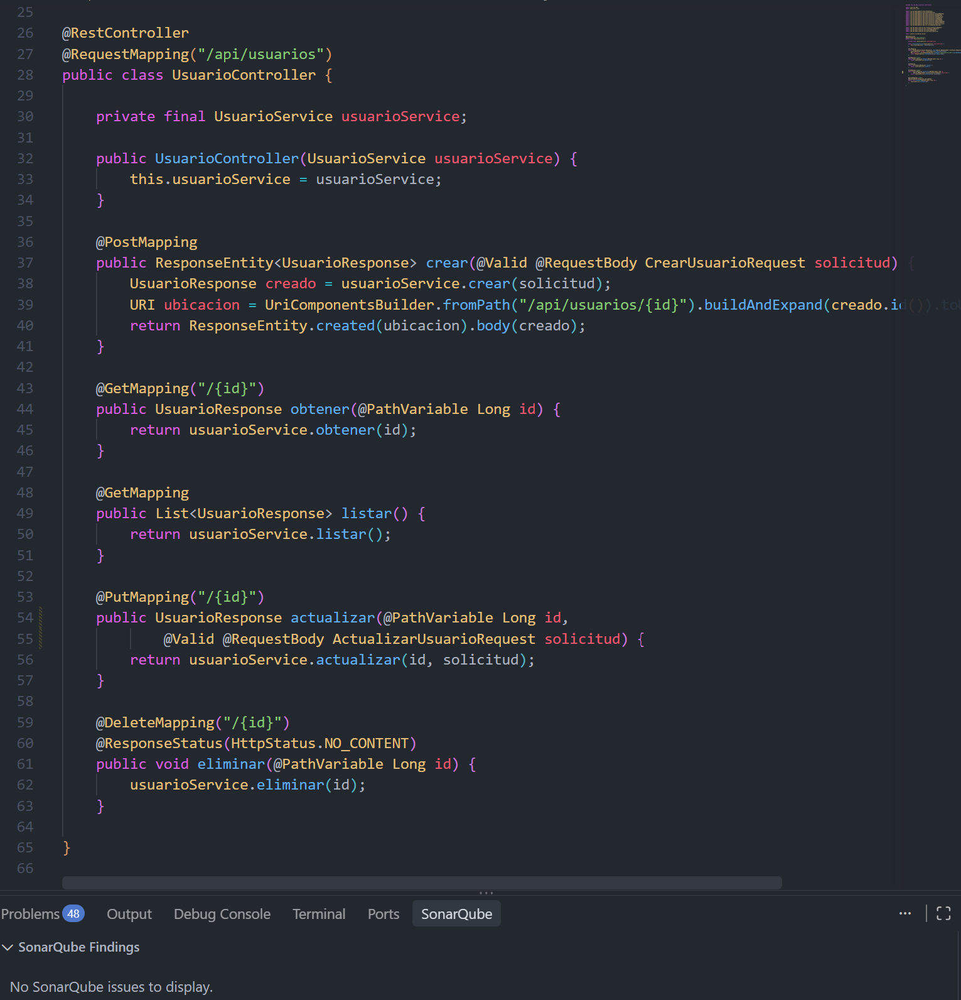

# Reporte de calidad — `ms-usuarios`

**Práctica:** P2 — Calidad como código con instrucciones y skills
**Estado del documento:** informe final de la Práctica 2 con la línea base y las ejecuciones fallidas anteriores conservadas. **Estado ejecutivo (ejecución final del 06/11/2026, 23:55:49, UTC-06:00):** `.\mvnw.cmd -B clean verify` sin omisiones terminó en **`BUILD SUCCESS`** **[D]**. Checkstyle, PMD, CPD, SpotBugs, JaCoCo y las 13 pruebas cumplen. **OWASP Dependency-Check 13.0.0 aprobó su gate, pero no porque las vulnerabilidades estén corregidas ni porque no existan:** 15 CVE con CVSS ≥ 7 quedan bajo supresión documentada (5 asociaciones incorrectas de componente, con vencimiento 2027-02-06, y 10 aceptaciones temporales de riesgo, con vencimiento 2026-12-06) y 8 CVE con CVSS < 7 siguen activos. Las 10 aceptaciones son una decisión interna del responsable del desarrollo, **sin aprobación de un tercero**, y **no sustituyen** una actualización a versiones corregidas. Al vencer la aceptación (2026-12-06) el gate puede volver a fallar.
**Fecha de la línea base:** 06/11/2026
**Fecha de la actualización final:** 06/11/2026 (ejecución final P2-23)

> **Resumen de estados de build (no deben confundirse; las dos primeras filas son ejecuciones anteriores):**
>
> | Ejecución | Resultado | Evidencia |
> |---|---|---|
> | `.\mvnw.cmd -B clean verify -Ddependency-check.skip=true` (OWASP omitido), **ejecución anterior** | `BUILD SUCCESS`; no demostraba el gate completo | **[D]** |
> | Ejecución individual de OWASP Dependency-Check 13.0.0 (umbral CVSS 7), **ejecución anterior, sin suppressions** | `BUILD FAILURE` por CVSS ≥ 7 (23 CVE, 15 con CVSS ≥ 7) | **[D]**; el estado de ese momento ya no está en `target/` (el JSON se regeneró) |
> | `.\mvnw.cmd -B clean verify` sin omisiones, **ejecución final** (06/11/2026, 23:55:49, UTC-06:00) | **`BUILD SUCCESS`**; 13 pruebas sin fallos, errores ni omitidas; OWASP aprobado con 15 CVE bajo supresión documentada | **[D]** (extracto de consola proporcionado por el desarrollador, sección 4.9); los resultados de los analizadores coinciden con `target/` **[V]** |

## Convención de evidencia

| Marca | Significado |
|---|---|
| **[V]** | Verificado directamente en archivos del repositorio. |
| **[D]** | Proporcionado por el desarrollador; no se pudo comprobar con los archivos disponibles. |

Los resultados marcados **[V]** en las secciones finales se leyeron de `target/` el 06/11/2026; el reporte de OWASP se regeneró en cada ejecución, por lo que solo el último estado (el de la ejecución final: 23 CVE detectados, 15 suprimidos y 8 activos) es verificable en archivos. Los estados anteriores (47, 27 y 23 CVE sin suppressions) se conservan como historial **[D]**.
| **[P]** | Pendiente. |

## 1. Objetivo y alcance

**Objetivo:** establecer la línea base de calidad de `ms-usuarios` antes de corregir hallazgos, documentar con evidencia los resultados antes y después de cada corrección, y consolidar el estado final de la práctica.

**Alcance:**
- Código Java de `src/main/java` y pruebas de `src/test/java`.
- Dependencias del proyecto (Maven, Spring Boot 3.5.16).
- Reglas definidas en `.github/copilot-instructions.md` y en la skill `.github/skills/quality-gates-java/SKILL.md`.

**Fuera de alcance:**
- JWT y autorización por roles (corresponden a P3).
- Migración a Spring Boot 4 / Spring Framework 7 (descartada en esta práctica; ver sección 6.6).
- Actualización de Spring Framework, Spring Security y Spring Data (sus correcciones compatibles requieren soporte Enterprise).

**Nota histórica:** la versión de la línea base declaraba como fuera de alcance «correcciones de código y actualizaciones de dependencias (no aplicadas)». Esa afirmación era válida el 06/11/2026 en el diagnóstico inicial; los lotes aplicados después se documentan en la sección 7.3.

## 2. Herramientas utilizadas y versiones

Versiones tomadas de `pom.xml` y de los encabezados de los reportes **[V]**.

| Herramienta | Plugin / versión | Motor o dato adicional | Configuración |
|---|---|---|---|
| Checkstyle | `maven-checkstyle-plugin` 3.6.0 | Checkstyle 10.21.4 | `config/checkstyle/checkstyle.xml`; fase `validate`; `failOnViolation=true`; severidad `warning` |
| PMD | `maven-pmd-plugin` 3.26.0 | PMD 7.7.0 (reporte) | `config/pmd/ruleset.xml` |
| CPD | `maven-pmd-plugin` 3.26.0 (`cpd-check`) | PMD 7.7.0 (reporte) | `minimumTokens=80` |
| SpotBugs | `spotbugs-maven-plugin` 4.9.3.0 | SpotBugs 4.9.3 (reporte) | `effort=Max`, `threshold=Medium` |
| FindSecBugs | `findsecbugs-plugin` 1.14.0 | Plugin de SpotBugs | Referenciado en el reporte de SpotBugs |
| OWASP Dependency-Check | `dependency-check-maven` **13.0.0** (línea base: 12.1.0) | Versión 13.0.0 (reporte JSON actual) | `failBuildOnCVSS=7`; clave NVD desde `NVD_API_KEY`; formatos HTML y JSON; sin `ossIndexServerId` **[V]** |
| JaCoCo | `jacoco-maven-plugin` 0.8.13 | — | Límite BUNDLE, contador LINE, mínimo 0.70 |
| JUnit 5 / Mockito / MockMvc | Spring Boot 3.5.16 (BOM) | Java 21 | Reportes en `target/surefire-reports` |
| SonarQube for IDE | Extensión de VS Code, versión 6.2.0 **[D]** | Análisis del archivo abierto; no hay evidencia de modo conectado a un servidor **[P]** | Evidencia limitada a `UsuarioController.java` (sección 10.1); no hay análisis de todo el proyecto |

**Reglas de Checkstyle activas [V]:** `LineLength` (120), `UnusedImports`, `MagicNumber`, `MultipleStringLiterals`, `CyclomaticComplexity` (10), `MethodLength` (30), `ParameterNumber` (5), `EmptyCatchBlock`, `NeedBraces`.

**Pendiente [P]:** versión del Maven Wrapper y de la JDK usada en las ejecuciones.

## 3. Tabla comparativa antes/después

| Herramienta | Antes (línea base) | Después (estado final) | Estado |
|---|---|---|---|
| Checkstyle | 19 violaciones (8 MagicNumber, 7 LineLength, 4 MultipleStringLiterals) **[V]** | 0 violaciones **[V]** (`target/checkstyle-result.xml` sin entradas de error) | Cumple |
| PMD | 0 violaciones **[V]** | 0 violaciones **[V]** | Cumple |
| CPD | 0 duplicaciones **[V]** | 0 duplicaciones **[V]** | Cumple |
| SpotBugs/FindSecBugs | 0 incidencias **[V]** | 0 incidencias **[V]** | Cumple |
| JaCoCo (líneas) | 71.77 % (89/124); umbral 70 % **[V]** | 71.43 % (90/126); umbral 70 % **[V]** | Cumple; margen de 1.43 puntos |
| JaCoCo (instrucciones, informativo) | 68.3 % (362/530) **[V]** | 68.3 % (362/530) **[V]** | No es la métrica del umbral |
| Pruebas | 13 aprobadas, 0 fallos, 0 errores **[V]** | 13 aprobadas, 0 fallos, 0 errores, 0 omitidas **[V]** | Cumple |
| OWASP: dependencias escaneadas | 71 (49 únicas) **[V]** (12.1.0) | No registrado para 13.0.0 | Pendiente **[P]** |
| OWASP: dependencias con alertas | 10 **[V]** (12.1.0) | 3 (spring-core, spring-security-crypto, spring-data-jpa) **[V]** (13.0.0) | Mejora; no comparable directamente (motor distinto) |
| OWASP: asociaciones dependencia-CVE | 70 **[V]** (12.1.0) | 23 **[V]** (13.0.0) | No equivale a CVE únicos |
| OWASP: CVE | No determinado en la línea base | 47 → 27 → 23 (ver sección 6.4); 47 y 27 **[D]**, 23 **[V]**. Ejecución final: 23 detectados = 15 suprimidos + 8 activos **[V]** | Persisten alertas: 8 activas y 15 bajo supresión |
| OWASP: CVE con CVSS ≥ 7 | Pendiente en la línea base | 15 **[V]** (12 en spring-core y 3 en spring-security-crypto); en la ejecución final los 15 figuran como suprimidos, no como corregidos **[V]** | Gate aprobado por supresión documentada (5 asociaciones incorrectas + 10 aceptaciones temporales) |
| OWASP: CVSS máximo reportado | 9.8 **[D]** | 9.8 **[V]** (CVE de spring-core en el JSON; ahora suprimidos) | Sin reducción del CVSS; el máximo activo es 6.5 **[V]** |
| OWASP: resultado del build | `BUILD FAILURE` por CVSS ≥ 7.0 **[D]** | Ejecuciones anteriores: `BUILD FAILURE` en OWASP **[D]**. Ejecución final (23:55:49): gate aprobado **[D]** | **Supera el gate con 15 CVE suprimidos**, no sin vulnerabilidades |
| OWASP: errores de herramienta | HTTP 401 de OSS Index **[V]**; URL largas en la actualización de datos **[D]** | 13.0.0 generó el reporte JSON **[V]**; OSS Index deshabilitado por falta de credenciales de Sonatype **[D]** (ver sección 6.2) | OSS Index sin cobertura |
| SonarQube for IDE | Pendiente | Análisis de `UsuarioController.java`: 0 issues y 0 Security Hotspots **[D]**; captura **[V]** (sección 10.1) | Evidencia parcial: un solo archivo, no el proyecto completo |
| `.\mvnw.cmd -B clean verify -Ddependency-check.skip=true` | Sin ejecución completa | `BUILD SUCCESS` **[D]** (OWASP omitido; ejecución anterior) | No equivalía a cumplir el gate completo |
| `.\mvnw.cmd -B clean verify` (sin omisiones) | Pendiente de una ejecución completa | **`BUILD SUCCESS`** **[D]** (06/11/2026, 23:55:49, UTC-06:00); ver sección 4.9 | Cumple, con las supresiones y aceptaciones de las secciones 6.4 y 6.8 |

## 4. Resultados iniciales por herramienta

### 4.1 Checkstyle **[V]** (`target/checkstyle-result.xml`)

19 violaciones en 5 archivos Java:

| Regla | Cantidad | Archivos |
|---|---|---|
| MagicNumber | 8 | `Usuario.java` (3), `CrearUsuarioRequest.java` (3), `ActualizarUsuarioRequest.java` (2) |
| LineLength | 7 | `ApiExceptionHandler.java` (6), `UsuarioController.java` (1) |
| MultipleStringLiterals | 4 | `ApiExceptionHandler.java` |

Las violaciones son de estilo y mantenimiento, no errores de compilación. Como la regla se ejecuta en la fase `validate` con `failOnViolation=true`, bloquea el build antes que el resto de los análisis.

### 4.2 PMD **[V]** (`target/pmd.xml`)
0 violaciones con las reglas de `config/pmd/ruleset.xml` (código muerto, complejidad, código duro).

### 4.3 CPD **[V]** (`target/cpd.xml`)
0 duplicaciones con `minimumTokens=80`.

### 4.4 SpotBugs con FindSecBugs **[V]** (`target/spotbugsXml.xml`)
0 incidencias con umbral `Medium` y esfuerzo `Max`.

### 4.5 JaCoCo **[V]** (`target/site/jacoco/jacoco.csv`)

| Contador | Cubierto / total | Porcentaje |
|---|---|---|
| Líneas (umbral) | 89 / 124 | **71.77 %** |
| Instrucciones | 362 / 530 | 68.3 % |
| Ramas | 11 / 32 | 34.4 % |

El umbral de 70 % se aplica a líneas. Clases con menor cobertura de líneas: `ApiExceptionHandler` (14/34) y `UsuarioService` (23/35). El margen sobre el umbral es de 1.77 puntos porcentuales.

### 4.6 Pruebas **[V]** (`target/surefire-reports`)
13 pruebas aprobadas, 0 fallos, 0 errores, 0 omitidas: `UsuarioControllerTest` (8), `UsuarioServiceTest` (3), `CrearUsuarioRequestTest` (1) y `MsUsuariosApplicationTests` (1).

### 4.7 Procedencia de los resultados
Los reportes corresponden a ejecuciones distintas (por ejemplo, PMD y CPD a las 18:06 y OWASP a las 18:53) en la línea base. La ejecución completa de `.\mvnw.cmd -B clean verify` del 06/11/2026, 23:55:49 consolidó el estado final (sección 4.9), donde se incorpora el extracto final de consola proporcionado por el desarrollador **[D]**; la salida completa no está archivada **[P]**.

### 4.8 Resultados finales (06/11/2026)

| Herramienta | Resultado final | Fuente |
|---|---|---|
| Checkstyle | 0 violaciones | `target/checkstyle-result.xml` **[V]** |
| PMD | 0 violaciones | `target/pmd.xml` **[V]** |
| CPD | 0 duplicaciones | `target/cpd.xml` **[V]** |
| SpotBugs/FindSecBugs | 0 incidencias | `target/spotbugsXml.xml` **[V]** |
| Pruebas | 13 aprobadas (`UsuarioControllerTest` 8, `UsuarioServiceTest` 3, `CrearUsuarioRequestTest` 1, `MsUsuariosApplicationTests` 1) | `target/surefire-reports` **[V]** |
| JaCoCo | Líneas 71.43 % (90/126); instrucciones 68.3 % (362/530); ramas 34.4 % (11/32) | `target/site/jacoco/jacoco.csv` **[V]** |
| OWASP | 23 CVE en 3 dependencias; 15 con CVSS ≥ 7 (estado **anterior** a las suppressions, que llevó al `BUILD FAILURE`). En la ejecución final siguen detectados los 23, de los cuales 15 están suprimidos y 8 activos con CVSS < 7 (sección 6.4) | `target/dependency-check-report.json` (13.0.0, generado el 06/11/2026, 23:55:48 UTC-06:00) **[V]** |

Cobertura de líneas por clase con menor porcentaje: `ApiExceptionHandler` (15/36) y `UsuarioService` (23/35). La clase `RestriccionesUsuario` (solo constantes) no aparece en `jacoco.csv`. Frente a la línea base (71.77 %, 89/124), el estado final tiene 1 línea cubierta y 1 no cubierta más (90/126); el número de líneas de `ApiExceptionHandler` pasó de 34 a 36 (14 → 15 cubiertas). No se analizó la causa de cada línea adicional; el porcentaje se toma únicamente de `jacoco.csv`.

**Resultados de build (distintos entre sí; las dos primeras filas son ejecuciones anteriores):**

| Ejecución | Resultado | Evidencia |
|---|---|---|
| `.\mvnw.cmd -B clean verify -Ddependency-check.skip=true` (anterior) | `BUILD SUCCESS`; 13 pruebas y umbral JaCoCo satisfechos. OWASP **omitido**. | **[D]**; los resultados de cada analizador coinciden con los archivos de `target/` **[V]** |
| Ejecución individual de OWASP 13.0.0 (`failBuildOnCVSS=7`), anterior y sin suppressions | `BUILD FAILURE`: 15 CVE alcanzan CVSS ≥ 7 | **[D]**; los CVE están en el JSON **[V]** (hoy como suprimidos) |
| `.\mvnw.cmd -B clean verify` sin omisiones (**final**, 06/11/2026, 23:55:49, UTC-06:00) | **`BUILD SUCCESS`** (sección 4.9) | **[D]**; extracto de consola con `BUILD SUCCESS` en la sección 4.9 (proporcionado por el desarrollador, no archivado como log) |

El `BUILD SUCCESS` con OWASP omitido **no** demostraba que el quality gate completo se cumpliera; el `BUILD SUCCESS` final sí incluye OWASP, con las supresiones descritas en las secciones 6.4 y 6.8.

### 4.9 Ejecución final de Maven (P2-23)

**Comando:** `.\mvnw.cmd -B clean verify` (sin parámetros para omitir controles). **Fecha de finalización:** 06/11/2026, 23:55:49 (UTC-06:00). No se ejecutó Maven al redactar este informe.

**Evidencia textual de consola (P2-24).** Las 15 últimas líneas de la salida, transcritas sin cambios, fueron **proporcionadas por el desarrollador [D]**. No proceden de un archivo de log almacenado en el repositorio ni de `target/`; la salida completa de la ejecución no está archivada **[P]**.

```text
[INFO]
[INFO] --- jacoco:0.8.13:report (report) @ ms-usuarios ---
[INFO] Loading execution data file C:\Users\migue\Documents\Proyectos\MS-Users\beca-ia-miguelmartinez\target\jacoco.exec
[INFO] Analyzed bundle 'ms-usuarios' with 12 classes
[INFO]
[INFO] --- jacoco:0.8.13:check (check) @ ms-usuarios ---
[INFO] Loading execution data file C:\Users\migue\Documents\Proyectos\MS-Users\beca-ia-miguelmartinez\target\jacoco.exec
[INFO] Analyzed bundle 'ms-usuarios' with 12 classes
[INFO] All coverage checks have been met.
[INFO] ------------------------------------------------------------------------
[INFO] BUILD SUCCESS
[INFO] ------------------------------------------------------------------------
[INFO] Total time:  45.008 s
[INFO] Finished at: 2026-11-06T23:55:49-06:00
[INFO] ------------------------------------------------------------------------
```

Este extracto respalda textualmente `All coverage checks have been met`, `BUILD SUCCESS`, la duración (45.008 s) y la finalización a las 23:55:49 (UTC-06:00). **No muestra** las fases de pruebas, Checkstyle, PMD, CPD, SpotBugs ni OWASP; esos resultados se sustentan en lo informado por el desarrollador **[D]** y en los reportes de `target/` **[V]** de la tabla siguiente. Las 12 clases analizadas por JaCoCo coinciden con las 12 filas de `jacoco.csv` **[V]**.

| Control | Resultado reportado **[D]** | Contraste con archivos de `target/` **[V]** |
|---|---|---|
| Build | `BUILD SUCCESS` (extracto de consola de esta sección) | No verificable en archivos; respaldado solo por el extracto proporcionado por el desarrollador **[D]** |
| Pruebas | 13 ejecutadas, 0 fallos, 0 errores, 0 omitidas | `target/surefire-reports`: 3 + 1 + 1 + 8 = 13 pruebas, 0 fallos, 0 errores, 0 omitidas |
| Checkstyle | 0 violaciones | `target/checkstyle-result.xml` sin entradas `<error>` |
| PMD y CPD | Ejecución satisfactoria | `target/pmd.xml` sin `<violation>`; `target/cpd.xml` sin `<duplication>` |
| SpotBugs | 0 incidencias | `target/spotbugsXml.xml` sin `<BugInstance>` |
| JaCoCo | `All coverage checks have been met` (en el extracto de consola) | `target/site/jacoco/jacoco.csv`: líneas 90 cubiertas y 36 no cubiertas = **71.43 %** (90/126); instrucciones 362/530 = 68.3 %; ramas 11/32 = 34.4 %. Umbral de líneas: 70 % |
| OWASP Dependency-Check 13.0.0 | Gate aprobado con 15 CVE bajo supresión documentada; 8 CVE activos con CVSS < 7 | `target/dependency-check-report.json` (`reportDate` 2026-11-07T05:55:48Z = 23:55:48 UTC-06:00, un segundo antes de la hora registrada): 8 `vulnerabilities` y 15 `suppressedVulnerabilities` |
| PostgreSQL y Flyway | PostgreSQL 16.15 y migración V1 validadas | No verificable en archivos; las pruebas de contexto dependen de PostgreSQL local (sección 10.3) |

Los porcentajes de JaCoCo se calcularon sumando las columnas `LINE_*`, `INSTRUCTION_*` y `BRANCH_*` de `jacoco.csv`; coinciden con los de la sección 4.8, por lo que el margen sobre el umbral sigue siendo de 1.43 puntos porcentuales.

**Qué demuestra y qué no:** el gate de OWASP se aprobó porque 15 CVE tienen una supresión vigente; **no** porque estén corregidos ni porque el proyecto no tenga vulnerabilidades. Quedan 8 CVE activos por debajo del umbral y las 10 aceptaciones temporales vencen el 2026-12-06.

## 5. Hallazgos relevantes de Checkstyle

### Hallazgo 1 — MagicNumber (8 violaciones, 3 archivos)

| Aspecto | Detalle |
|---|---|
| Ubicación | `Usuario.java` (líneas 25, 28, 35: 120, 254, 20); `CrearUsuarioRequest.java` (14, 15, 16: 120, 254, 8); `ActualizarUsuarioRequest.java` (10, 11: 120, 254) |
| Problema | Los límites de longitud están escritos como literales en anotaciones de JPA y de validación. Los valores 120 y 254 se repiten en tres archivos. |
| Impacto | Riesgo de que los límites se desincronicen entre la entidad, los DTOs y el esquema. Hoy coinciden con `VARCHAR(120)`, `VARCHAR(254)` y `VARCHAR(20)` de `V1__create_usuarios.sql` **[V]**. Es un riesgo de mantenimiento, no un defecto funcional. |
| Corrección propuesta en la línea base **[P]** | Reemplazar los literales por constantes con nombre, sin cambiar los valores ni el comportamiento. No se modifica la migración Flyway. Si se crea una clase de constantes, requiere aprobación. |
| **Acción correctiva aplicada (P2-05) [V]** | Se creó `domain/RestriccionesUsuario.java` con `LONGITUD_MAXIMA_NOMBRE = 120`, `LONGITUD_MAXIMA_EMAIL = 254` y `LONGITUD_MAXIMA_ROL = 20`, y se usaron en `Usuario.java`, `CrearUsuarioRequest.java` y `ActualizarUsuarioRequest.java`. El mínimo de contraseña (8) quedó como constante privada `LONGITUD_MINIMA_PASSWORD` del propio record. Aprobada por el desarrollador (alternativa 3). |
| Resultado | 8 → 0 violaciones de MagicNumber **[V]**. Los valores coinciden con `VARCHAR(120)`, `VARCHAR(254)` y `VARCHAR(20)` de `V1__create_usuarios.sql`, que no se modificó. Las 13 pruebas siguen aprobadas **[V]**. |

### Hallazgo 2 — MultipleStringLiterals (4 violaciones, 1 archivo)

| Aspecto | Detalle |
|---|---|
| Ubicación | `ApiExceptionHandler.java`, líneas 49-51: `"La solicitud contiene datos inválidos."`, `"errors"`, `"campo"`, `"mensaje"`, cada uno repetido 2 veces |
| Problema | Los mismos textos y claves del cuerpo de error se escriben más de una vez. |
| Impacto | Riesgo de inconsistencias en el contrato de errores (`ProblemDetail`) si se edita solo una de las apariciones. |
| Corrección propuesta en la línea base **[P]** | Extraer constantes privadas con los mismos valores, sin alterar mensajes ni claves de las respuestas HTTP. |
| **Acción correctiva aplicada (P2-04) [V]** | En `ApiExceptionHandler.java` se declararon `MENSAJE_DATOS_INVALIDOS = "La solicitud contiene datos inválidos."`, `ERRORS_PROPERTY = "errors"`, `CLAVE_CAMPO = "campo"` y `CLAVE_MENSAJE = "mensaje"`, con los mismos valores originales. |
| Resultado | 4 → 0 violaciones de MultipleStringLiterals **[V]**. Textos, claves JSON y códigos HTTP sin cambios; las 13 pruebas siguen aprobadas **[V]**. |

### Hallazgo 3 — LineLength (7 violaciones, 2 archivos)

| Aspecto | Detalle |
|---|---|
| Ubicación | `ApiExceptionHandler.java` (líneas 51, 67, 70, 72, 98, 105; de 122 a 132 caracteres) y `UsuarioController.java` (línea 54; 122 caracteres) |
| Problema | Líneas por encima del límite de 120 caracteres. Los archivos usan tabuladores; los conteos reportados son consistentes con tabuladores computados como 8 columnas (por ejemplo, la línea 98 de `ApiExceptionHandler.java` y la 54 del controlador). |
| Impacto | Legibilidad y mantenimiento. Sin impacto funcional ni de seguridad. |
| Corrección propuesta en la línea base **[P]** | Reformatear las líneas, sin cambiar lógica ni textos. |
| **Acción correctiva aplicada (P2-04) [V]** | Se reformatearon las 6 líneas de `ApiExceptionHandler.java` y la línea 54 de `UsuarioController.java`, sin cambiar lógica, rutas ni textos. |
| Resultado | 7 → 0 violaciones de LineLength **[V]**. Con las tres reglas, Checkstyle pasó de 19 a 0 violaciones. |

Los tres hallazgos de esta sección son de estilo y mantenimiento. Los hallazgos de seguridad de dependencias (OWASP) se tratan en la sección 6.

## 6. Alertas de OWASP y limitaciones del análisis

Las secciones 6.1 a 6.3 conservan la lectura de la **línea base** con Dependency-Check 12.1.0. El estado final con 13.0.0 está en las secciones 6.4 a 6.7.

### 6.1 Alertas de dependencias (línea base)
Datos del encabezado de `target/dependency-check-report.html` (Dependency-Check 12.1.0) **[V]**:

| Concepto | Valor |
|---|---|
| Dependencias escaneadas | 71 (49 únicas) |
| Dependencias vulnerables | 10 |
| Vulnerabilidades encontradas (asociaciones dependencia-CVE) | 70 |
| Vulnerabilidades suprimidas | 0 |

Métrica reportada por la consola de OWASP:

| Métrica | Antes | Después |
|---|---|---|
| CVSS máximo reportado | 9.8 **[D]** | 9.8 **[V]** (13.0.0; CVE de spring-core en el JSON) |

- Los 70 son asociaciones dependencia-CVE, no CVE únicos. Un mismo CVE puede aparecer asociado a varias dependencias. El número de CVE únicos de la línea base quedó **[P]**; las cifras del estado final están en la sección 6.4.
- El CVSS máximo de 9.8 lo proporcionó el desarrollador a partir de la consola de OWASP **[D]**. En el reporte final (13.0.0) hay 5 CVE de spring-core con 9.8 **[V]**.
- Una alerta de OWASP indica una coincidencia entre una dependencia y un identificador conocido. **No demuestra que el microservicio sea explotable**, ni siquiera con un CVSS alto. Cada alerta requiere triage: versión realmente afectada, ruta de ejecución y posible falso positivo.
- En el HTML se observan referencias a avisos de seguridad de Spring (`CVE-2026-59314`, `CVE-2026-47834` y `CVE-2026-59276`). No se confirmó la dependencia asociada ni el CVSS de cada una.
- El resultado `BUILD FAILURE` por vulnerabilidades con CVSS ≥ 7.0 es un dato proporcionado por el desarrollador **[D]**. No hay consola en el repositorio para verificarlo.

### 6.2 Errores de configuración de la herramienta (distintos de las alertas)

| Error | Evidencia | Naturaleza |
|---|---|---|
| HTTP 401 Unauthorized de OSS Index (12.1.0) | **[V]** en la sección «Analysis Exceptions» del HTML de la línea base (leído el 06/11/2026; el archivo se sobrescribió con el reporte de 13.0.0) | Autenticación del analizador OSS Index de Dependency-Check (Sonatype). No es un problema del código. Es independiente del error de metadatos de Flyway descrito abajo. |
| Advertencia HTTP 401 al obtener metadatos Maven del repositorio `flyway-community-db-support` | **[D]**: registro de consola proporcionado por el desarrollador el 06/11/2026, todavía no archivado en el repositorio. Comando: `.\mvnw.cmd -B clean verify -Ddependency-check.skip=true`. Mensaje: `[WARNING] Could not transfer metadata /.meta/prefixes.txt from/to flyway-community-db-support (https://maven.pkg.github.com/flyway/flyway-community-db-support): HTTP Status: 401`. No existe evidencia verificable en el repositorio ni en `target/` (el HTML actual no contiene ningún 401); es un registro histórico de consola. | Es una advertencia (`[WARNING]`) de obtención de metadatos Maven; no impidió el `BUILD SUCCESS` de esa ejecución, y Flyway validó correctamente la migración V1 según el mismo registro **[D]**. No guarda relación con la autenticación de Sonatype OSS Index ni con Dependency-Check. |
| URL demasiado largas al actualizar los datos de Dependency-Check 12.1.0 | **[D]**; no figura en el HTML | Problema de la herramienta o de su base interna. No es un problema del código. El desarrollador indicó que 12.2.2 corrigió el problema y se actualizó a 13.0.0 (sección 7.3, lote P2-06); no hay salida de consola que confirme la desaparición del error **[P]**. |
| OSS Index deshabilitado automáticamente en 13.0.0 por falta de credenciales de Sonatype | **[D]**; `pom.xml` no declara `ossIndexServerId` **[V]** | Limitación de configuración: no hay token de Sonatype Guide. Es una condición distinta del HTTP 401 observado en la línea base. |

**Efecto:** con OSS Index deshabilitado, ese analizador no aporta resultados al reporte de 13.0.0. No se ha medido cuánta cobertura se pierde **[P]**.

**Decisión sobre OSS Index:** no se autoriza desactivar ese analizador sin evaluar antes las alternativas y las consecuencias para la cobertura del análisis de seguridad. Cualquier cambio adicional en la configuración de OWASP requiere aprobación previa.

### 6.3 Limitaciones de lectura del reporte
- El HTML de la línea base (12.1.0) tiene una línea de unos 387 KB y las herramientas de lectura solo muestran su inicio.
- Las 10 dependencias de la línea base y sus CVE únicos **no se identificaron** **[P]**. Desde la versión 13.0.0 existe `target/dependency-check-report.json`, que permite el detalle por dependencia (secciones 6.4 y 6.6).
- Solo se conserva el JSON del último escaneo (23 CVE). Los reportes de los estados de 47 y 27 CVE se sobrescribieron y esas cifras son **[D]**.

### 6.4 Evolución de las vulnerabilidades detectadas (Dependency-Check 13.0.0)

| Estado | CVE | Dependencias con alertas | Cambio aplicado | Evidencia |
|---|---|---|---|---|
| Primer escaneo con 13.0.0 | 47 | 7 | — | **[D]** |
| Tras `postgresql.version=42.7.14` y `tomcat.version=10.1.61` | 27 | 5 | −20 | **[D]** |
| Tras `log4j2.version=2.25.5` y `jackson-bom.version=2.21.5` | 23 | 3 | −4 | **[V]** (`target/dependency-check-report.json`, 06/11/2026) |

Reducción acumulada: 47 → 23 CVE (−24) detectados. Composición del estado de 23 CVE **[V]** (anterior a las suppressions, que llevó al `BUILD FAILURE`):

| Dependencia | Versión | CVE | CVSS ≥ 7 | CVSS por CVE |
|---|---|---|---|---|
| `spring-core` | 6.2.19 | 17 | 12 | 9.8 (5), 9.1 (1), 7.5 (6), 6.1 (3), 4.3 (1), 3.7 (1) |
| `spring-security-crypto` | 6.5.11 | 5 | 3 | 9.1, 7.4, 7.4, 6.5, 5.9 |
| `spring-data-jpa` | 3.5.13 | 1 | 0 | 6.5 |
| **Total** | | **23** | **15** | |

- Dependencias que dejaron de tener alertas: `tomcat-embed-core`, `postgresql`, `log4j-api` y `jackson-databind` (versiones 10.1.61, 42.7.14, 2.25.5 y 2.21.5 en el reporte) **[V]**. La eliminación de sus CVE se limita a lo que el escáner detecta con esas versiones; no es una garantía de ausencia de otros riesgos.
- Los CVSS corresponden a los valores del reporte (NVD). Pueden diferir de la severidad del proveedor.
- **La reducción de 47 a 23 no elimina todos los riesgos de seguridad:** se detectaron 23 alertas, 15 de ellas bloqueantes antes de las suppressions, y OSS Index no está activo.

**Estado de los 23 CVE en la ejecución final (06/11/2026, 23:55:49)** **[V]** (`target/dependency-check-report.json`: 8 `vulnerabilities` y 15 `suppressedVulnerabilities`). Las tres categorías son distintas y no deben mezclarse:

| Categoría | CVE | Dependencia / módulo en el JSON | CVSS | Tratamiento | Vencimiento |
|---|---|---|---|---|---|
| **Detectados y activos (no bloquean)** | 8: CVE-2026-47883, 47887, 59281, 59280, 59314 (spring-core); CVE-2026-47834 (spring-data-jpa); CVE-2026-47842, 59276 (spring-security-crypto) | `spring-core` 6.2.19 (5), `spring-data-jpa` 3.5.13 (1), `spring-security-crypto` 6.5.11 (2) | 6.1, 6.1, 6.1, 4.3, 3.7 / 6.5 / 6.5, 5.9 (máximo 6.5) | Siguen presentes y sin corregir; quedan bajo el umbral `failBuildOnCVSS=7`. No se validaron individualmente (salvo el caso límite de CVE-2026-59281, sección 6.6) | No aplica |
| **Falsas asociaciones de componente (suprimidas)** | 5: CVE-2026-47888 y 47893 (Framework, 12 artefactos 6.2.19), CVE-2026-59270, 41707 y 47841 (`spring-security-crypto` 6.5.11) | Los módulos realmente afectados (`spring-messaging`, `spring-webflux`, `spring-security-ldap`, `spring-security-oauth2-jose`, `spring-security-web`) no están en el árbol de dependencias | 7.5, 7.5, 9.1, 7.4, 7.4 | Suppressions de identificación incorrecta por CPE en `config/owasp-suppressions.xml` | 2027-02-06 |
| **Aceptaciones temporales de riesgo (suprimidas, no son falsos positivos)** | 10: CVE-2026-47884, 47885, 47886, 47890, 47891, 47892, 59282, 59283, 59313, 47889 | Módulos de Spring Framework 6.2.19 presentes; funcionalidad vulnerable no observada (sección 6.8) | 9.8, 7.5, 7.5, 9.8, 9.8, 9.8, 7.5, 9.1, 9.8, 7.5 | Decisión interna del responsable del desarrollo; **sin aprobación externa**; sin corrección aplicada | 2026-12-06 |

Total: 8 + 5 + 10 = 23 CVE detectados; 15 suprimidos (5 + 10) y 8 activos. Las suppressions de Framework usan expresiones regulares de lista cerrada de 12 artefactos 6.2.19, por lo que también ocultan esos CVE en los módulos donde sí reside la clase vulnerable (sección 6.8). Ninguno de los 15 está corregido.

### 6.5 Justificación de las actualizaciones de dependencias

Las versiones se gestionan mediante propiedades del BOM de Spring Boot 3.5.16 en `<properties>` de `pom.xml` **[V]**, sin declarar dependencias explícitas duplicadas. Spring Boot, Spring Framework, Spring Security y Spring Data no se modificaron.

| Propiedad | De → a | Motivo | Evidencia |
|---|---|---|---|
| `postgresql.version` | 42.7.11 → 42.7.14 | CVE-2026-54291 en el controlador JDBC; el aviso oficial identifica 42.7.12 como corrección y 42.7.14 es la última de la serie 42.7.x verificada | Versión en `pom.xml` y en el reporte **[V]**; aviso oficial consultado en P2-08 |
| `tomcat.version` | 10.1.55 → 10.1.61 | 19 CVE del Tomcat embebido; se mantiene la serie 10.1.x compatible con Spring Boot 3.5 | −19 CVE en el escaneo **[D]**; versión en el reporte **[V]** |
| `log4j2.version` | 2.24.3 → 2.25.5 | 3 CVE asociados a `log4j-api`; 2.25.5 es la versión corregida indicada en los avisos de Log4j. Parte de las alertas eran por coincidencia de CPE con artefactos ausentes (`log4j-1.2-api`, Log4j Core) | −3 CVE **[D]**; versión en el reporte **[V]** |
| `jackson-bom.version` | 2.21.4 → 2.21.5 | CVE-2026-54515 (CVSS 5.3) | −1 CVE **[D]**; versión en el reporte **[V]** |

Aplicabilidad de Log4j y Jackson en este microservicio: la explotación de CVE-2026-49844 y CVE-2026-54515 requiere funciones que el código no usa (`JsonTemplateLayout` y `MapMessage`; `@JsonIgnoreProperties` con `ACCEPT_CASE_INSENSITIVE_PROPERTIES`). Se actualizaron igualmente por ser un cambio de bajo riesgo dentro de la misma serie. La verificación de esas condiciones se hizo en P2-08 mediante lectura de `src`; no hay otro respaldo en el repositorio.

### 6.6 Riesgos pendientes de Spring

Los 23 CVE detectados están en componentes del núcleo de Spring Boot 3.5.16 (spring-core 6.2.19, spring-security-crypto 6.5.11 y spring-data-jpa 3.5.13). Esta sección conserva el análisis previo a las suppressions; el estado vigente tras la ejecución final está en las secciones 6.4 y 6.8.

| Aspecto | Detalle |
|---|---|
| Versiones corregidas de la serie compatible | Spring Framework 6.2.20, Spring Security 6.5.12 y Spring Data JPA 3.5.14. Según la comprobación de P2-08 en Maven Central y en los avisos de Spring, son **solo para clientes con soporte Enterprise** y no están en Maven Central. No hay copia de esa comprobación en el repositorio **[P]**. |
| Alternativa de código abierto | Las versiones corregidas públicas pertenecen a Spring Framework 7 / Spring Security 7, es decir, a Spring Boot 4. La migración se descartó en esta práctica por decisión del desarrollador. |
| Estado | **Limitación vigente, gestionada pero no resuelta.** Antes de las suppressions, OWASP fallaba por los 15 CVE de CVSS ≥ 7. En la ejecución final (06/11/2026, 23:55:49) el gate se aprobó porque esos 15 CVE están suprimidos: 5 por asociación incorrecta de componente (vencen 2027-02-06) y 10 por aceptación temporal de riesgo (vencen 2026-12-06, sección 6.8). `failBuildOnCVSS=7` se mantiene. **Ninguno está corregido**, y las versiones corregidas siguen siendo solo Enterprise (Framework 6.2.20, Security 6.5.12) o de la serie 7 / Spring Boot 4. |
| Triage preliminar por código (P2-08) | No se encontraron en `src` usos de WebFlux, mensajería, WebSocket, SpEL, SSE, LDAP, WebAuthn ni `AesBytesEncryptor`. Seguridad usa solo `BCryptPasswordEncoder` (`PasswordConfig`). El único `Sort` de Spring Data es constante (`Sort.by(ASC, "id")`) y no hay consultas nativas. |
| Caso límite | CVE-2026-59281 (CVSS 6.1, spring-core): `ApiExceptionHandler` lee `getBindingResult().getFieldErrors()`, aunque la respuesta es `ProblemDetail` en JSON y no HTML. No se ha demostrado aplicabilidad ni inaplicabilidad **[P]**. |
| Severidad del proveedor | En los avisos de Spring consultados en P2-08, varios CVE tienen severidad menor que el CVSS de NVD del reporte (por ejemplo, CVE-2026-47884: 9.8 en NVD y MEDIUM en el aviso). Solo se revisaron 6 CVE de spring-core; el resto **[P]**. |

**Lo que no se concluye (análisis P2-08, anterior a las suppressions):** en ese momento ningún CVE se clasificaba como falso positivo definitivo; que las condiciones de explotación no se hayan observado en el código es una indicación de triage, no una prueba de inaplicabilidad. Posteriormente, P2-16 a P2-21 evaluaron individualmente los 15 CVE bloqueantes y se clasificaron así: 5 como asociación incorrecta de componente (módulos ausentes del árbol de dependencias, suprimidos hasta 2027-02-06) y 10 como componente presente con funcionalidad no observada, que **no** son falsos positivos y se aceptan temporalmente (sección 6.8). Las evaluaciones P2-16 a P2-21 no tienen entrada en la bitácora **[P]**. Los 8 CVE activos bajo el umbral no se validaron individualmente. Los CVE asociados por CPE a clases de LDAP, DPoP o WebAuthn en spring-security-crypto no se confirmaron con una inspección del JAR **[P]**; la ausencia de los módulos correspondientes se basa en el árbol de dependencias.

**Opciones para decidir (estado tras la ejecución final):**
1. Obtener soporte Enterprise de Spring, con las credenciales en `settings.xml` o variables de entorno, **nunca en el repositorio**. *No adoptada.*
2. Planificar la migración a Spring Boot 4 / Framework 7 en una práctica posterior. *Pendiente; es la corrección de fondo antes del vencimiento del 2026-12-06.*
3. Aceptar el riesgo con suppressions con caducidad. *Adoptada de forma temporal por decisión del responsable del desarrollo para los 10 CVE de la sección 6.8; las 5 asociaciones incorrectas se suprimieron por separado.* No sustituye las opciones 1 y 2.

**P3:** al incorporar Spring Security (JWT y roles), los CVE de spring-security-crypto deben reevaluarse.

### 6.7 Evidencias OWASP todavía pendientes **[P]**
- Salida de consola del escaneo OWASP con 13.0.0 (comando, fecha y líneas de la fase de OWASP). El extracto final del 06/11/2026, 23:55:49 (sección 4.9) solo cubre JaCoCo y el cierre del build, no la fase de OWASP.
- Copia del JSON del estado final (23 CVE detectados: 15 suprimidos y 8 activos) para conservarlo antes de regenerarlo.
- ~~Validación individual CVE por CVE de los 23 antes de cualquier supresión~~ Realizada para los 15 CVE suprimidos (P2-16 a P2-21, sin entradas de bitácora). Pendiente para los 8 CVE activos bajo el umbral.
- Inspección del despliegue (opciones de JVM, variables de entorno, proxies, exposición de red), que condiciona sobre todo a CVE-2026-59283.
- Token de Sonatype Guide y habilitación de OSS Index (`ossIndexServerId`, requiere aprobación).

### 6.8 Aceptación temporal de riesgos de 10 CVE de Spring Framework (P2-22)

**Estado: decisión documentada y verificada por la ejecución final (P2-23).** En la ejecución del 06/11/2026, 23:55:49 (UTC-06:00), `.\mvnw.cmd -B clean verify` terminó en `BUILD SUCCESS` **[D]** con estas 10 aceptaciones vigentes **[V]** (`suppressedVulnerabilities` del JSON). El gate se aprobó por la supresión temporal, no porque los CVE estén corregidos ni porque OWASP esté «limpio»: siguen detectados (sección 6.4).

**Alcance y naturaleza de la decisión**
- El responsable del desarrollo decidió **aceptar temporalmente el riesgo residual** de 10 CVE de Spring Framework 6.2.19 para el alcance actual de la práctica.
- **No son falsos positivos.** Los módulos afectados están presentes en el proyecto; lo que no se ha observado es la funcionalidad vulnerable. Se diferencian de las cinco suppressions de identificación incorrecta de componente (`spring-messaging`, `spring-webflux`, `spring-security-ldap`, `spring-security-oauth2-jose` y `spring-security-web`, ausentes del árbol), que no forman parte de esta sección.
- **Los CVE no están corregidos.** Esta decisión **no sustituye una actualización a versiones corregidas**: Spring Framework 6.2.20 es solo Enterprise y 7.0.9 (código abierto) pertenece a Spring Framework 7 / Spring Boot 4 (avisos oficiales enlazados abajo; sección 6.6).
- **No implica aprobación de un tercero.** Es una decisión interna del responsable del desarrollo; no hay aprobación externa, de seguridad ni del proveedor.
- **Vencimiento: 2026-12-06** para los 10 CVE. Se implementa con `until="2026-12-06Z"` en `config/owasp-suppressions.xml`; según el XSD de Dependency-Check, la regla deja de aplicarse en esa fecha y los CVE vuelven a bloquear el build.
- `failBuildOnCVSS=7`, OWASP y los demás controles de calidad no se modificaron.
- **Alcance técnico de las reglas:** cada regla usa un patrón cerrado de 12 artefactos de la versión 6.2.19 (`aop`, `aspects`, `beans`, `context`, `core`, `expression`, `jcl`, `jdbc`, `orm`, `tx`, `web` y `webmvc`), con un solo CVE. El patrón **oculta el CVE también en los módulos donde reside la clase vulnerable**; por eso se trata como aceptación de riesgo y no como corrección. No incluye `spring-messaging`, `spring-webflux`, `spring-test` ni otras versiones.

**Evidencia común**
- **[V]** `src` (principal y pruebas): un único `@RestController` (`UsuarioController`) con `@PathVariable Long` y `@Valid @RequestBody` (JSON). No se encontraron `Flux`, `Mono`, `RouterFunction`, `ServerResponse`, `SseEmitter`, `text/event-stream`, `XsltView`, `ViewResolver`, `SpelExpressionParser`, `@Value`, `@Query`, `DataBinder`, `@ModelAttribute`, `Jaxb`, Jetty, multipart, cookies ni CORS.
- **[V]** `pom.xml`: `spring-boot-starter-web` (servidor Tomcat, sin exclusiones), `data-jpa`, `validation`, `flyway`, `postgresql` y `spring-security-crypto`. Sin WebFlux, motor de vistas, actuator, Jetty ni Aalto como dependencias directas.
- **[V]** `application.yaml`: no define `spring.expression.compiler.mode`. `src/main/resources` solo contiene `application.yaml` y la migración Flyway; no existe `spring.properties`.
- **[V]** El repositorio no contiene Dockerfile, compose, flujos de CI ni `.mvn/jvm.config`: **no hay evidencia de cómo se despliega o ejecuta el servicio**.
- **[D]** Revisión del árbol Maven realizada por el desarrollador: no hay WebFlux, Reactor, Aalto ni Jetty. No se pudo comprobar con los archivos del repositorio.
- **[D]** Revisión de la configuración local por el desarrollador: no hay variables que activen explícitamente el compilador SpEL.
- **Riesgo residual común:** el despliegue (opciones de JVM, variables de entorno, proxies, exposición de red) no se ha inspeccionado; no se analizó el código de librerías de terceros; los endpoints actuales no tienen autenticación (JWT y roles son P3), por lo que los CVE de denegación de servicio no cuentan con esa barrera si el servicio se expone.

**Tabla 1. Identificación, condiciones y decisión**

| CVE | CVSS original (NVD) / severidad del aviso de Spring | Componente | Condición de explotación | Aviso oficial | Decisión |
|---|---|---|---|---|---|
| CVE-2026-47884 | 9.8 / MEDIUM | `spring-webmvc`, `XsltView` | `XsltView` con mapping `/**` que renderiza vistas sin nombre de vista explícito: SSRF y RCE | [aviso](https://spring.io/security/cve-2026-47884) | Aceptación temporal hasta 2026-12-06 |
| CVE-2026-47885 | 7.5 / MEDIUM | `spring-web`, `PartEventHttpMessageReader` | `@RequestBody Flux<PartEvent>` con `maxInMemorySize` en -1: DoS | [aviso](https://spring.io/security/cve-2026-47885) | Aceptación temporal hasta 2026-12-06 |
| CVE-2026-47886 | 7.5 / MEDIUM | `spring-expression`, operador `^` de SpEL | SpEL controlado por el usuario y un `BigDecimal` o `BigInteger` accesible: DoS | [aviso](https://spring.io/security/cve-2026-47886) | Aceptación temporal hasta 2026-12-06 |
| CVE-2026-47890 | 9.8 / LOW | Spring MVC y WebFlux, fragmentos de vista por SSE | Fragmentos de vista por SSE y atacante con control de datos transmitidos a otros usuarios | [aviso](https://spring.io/security/cve-2026-47890) | Aceptación temporal hasta 2026-12-06 |
| CVE-2026-47891 | 9.8 / MEDIUM | `Jaxb2Decoder` de WebFlux con Aalto | Aplicación WebFlux con el procesador XML Aalto: no se aplica `maxInMemorySize` | [aviso](https://spring.io/security/cve-2026-47891) | Aceptación temporal hasta 2026-12-06 |
| CVE-2026-47892 | 9.8 / MEDIUM | Endpoints funcionales (WebFlux) con `DispatcherServlet` | Predicado de cabecera omitido en una solicitud preflight | [aviso](https://spring.io/security/cve-2026-47892) | Aceptación temporal hasta 2026-12-06 |
| CVE-2026-59282 | 7.5 / MEDIUM | Data binding (`DataBinder`, `BeanWrapper`, `DirectFieldAccessor`) | Rutas de propiedades del usuario sobre un objeto con una `List` auto-poblada cuyos elementos tienen subpropiedades: DoS | [aviso](https://spring.io/security/cve-2026-59282) | Aceptación temporal hasta 2026-12-06 |
| CVE-2026-59283 | 9.1 / MEDIUM | `spring-expression`, `SimpleEvaluationContext` | `SimpleEvaluationContext` con el compilador SpEL activo (`IMMEDIATE` o `MIXED`): omisión de las protecciones | [aviso](https://spring.io/security/cve-2026-59283) | Aceptación temporal hasta 2026-12-06 |
| CVE-2026-59313 | 9.8 / LOW | Framework funcional de Spring MVC (`ServerResponse.sse()`) | SSE en texto plano con datos controlados por un atacante | [aviso](https://spring.io/security/cve-2026-59313) | Aceptación temporal hasta 2026-12-06 |
| CVE-2026-47889 | 7.5 / MEDIUM | `JettyCoreServerHttpResponse` (WebFlux sobre Jetty 12 Core) | Cookies sin el atributo `sameSite` en WebFlux sobre Jetty 12 Core | [aviso](https://spring.io/security/cve-2026-47889) | Aceptación temporal hasta 2026-12-06 |

Los CVSS son los del reporte de OWASP (NVD, `target/dependency-check-report.json` **[V]**); las severidades del proveedor se tomaron de los avisos oficiales. Spring Framework 6.2.0 a 6.2.19 figura como rango afectado en los diez avisos; todos indican 6.2.20 como versión corregida solo para soporte Enterprise. Solo se verificó en P2-16 el módulo que contiene la clase vulnerable de CVE-2026-47884, CVE-2026-47885, CVE-2026-47886 y CVE-2026-59283; para los demás se usa la descripción del aviso **[P]**.

**Tabla 2. Evidencia, mitigaciones, riesgo residual y reevaluación**

| CVE | Evidencia del código y de la configuración local | Mitigaciones existentes | Riesgo residual y limitaciones | Se reevalúa si |
|---|---|---|---|---|
| CVE-2026-47884 | **[V]** Sin `XsltView` ni `ViewResolver` en `src`; sin motor de vistas en `pom.xml`; solo un `@RestController`. | La API devuelve JSON; no renderiza vistas. | Es el CVE de mayor impacto (SSRF y RCE). Se desconoce el despliegue y no se descartó código de terceros que registre vistas. | Se agregan vistas (XSLT o plantillas) o mappings `/**` que renderizan vistas. |
| CVE-2026-47885 | **[V]** Sin `Flux`, `Mono` ni multipart en `src`; `pom.xml` sin WebFlux. **[D]** Árbol sin WebFlux ni Reactor. | Pila Spring MVC sobre Tomcat, no reactiva. | Los endpoints no tienen autenticación hasta P3. La ausencia en el árbol no se comprobó en el repositorio. | Se agregan WebFlux, Reactor o endpoints multipart. |
| CVE-2026-47886 | **[V]** Sin `SpelExpressionParser`, `@Value`, `@Query` ni `#{}` en `src`; sin actuator en `pom.xml`. | Ningún endpoint evalúa expresiones. | No se analizó si librerías de terceros evalúan SpEL con entrada del usuario. | Se evalúan expresiones SpEL con datos del usuario (por ejemplo, en la autorización de P3). |
| CVE-2026-47890 | **[V]** Sin `SseEmitter` ni `text/event-stream` en `src`; sin motor de plantillas. | Solo respuestas JSON síncronas. | Se desconoce el despliegue. | Se agregan SSE o plantillas de vista. |
| CVE-2026-47891 | **[V]** Sin XML, `Jaxb` ni WebFlux en `src`; Aalto no figura en `pom.xml`. **[D]** El árbol Maven no contiene WebFlux, Reactor ni Aalto. | Los DTO se reciben como JSON con Jackson; no hay procesamiento XML. | La ausencia en el árbol es un dato del desarrollador; no se inspeccionó el despliegue. | Se incorporan dependencias reactivas o procesamiento XML. |
| CVE-2026-47892 | **[V]** Sin `RouterFunction` ni `ServerResponse` en `src`; sin `@CrossOrigin` ni configuración CORS; mapeo solo con anotaciones. | No se usan endpoints funcionales. | Se desconoce el comportamiento de proxies o intermediarios del despliegue. | Se agregan endpoints funcionales, CORS o WebFlux. |
| CVE-2026-59282 | **[V]** El controlador solo usa `@PathVariable Long` y `@Valid @RequestBody`; sin `@ModelAttribute`, `DataBinder` ni `BeanWrapper`; sin `List` como propiedad en DTO ni entidades. `spring.jackson.deserialization.fail-on-unknown-properties` está en `true` en `application.yaml`. | Entrada JSON validada con Jakarta Validation; no se aplican rutas de propiedades del cliente. | No se analizó código de terceros que use el binding; endpoints sin autenticación hasta P3. | Se agrega binding de formularios o parámetros a objetos, o colecciones en los DTO. |
| CVE-2026-59283 | **[V]** Sin SpEL en `src`; `application.yaml` no define `spring.expression.compiler.mode`; no existe `spring.properties`. **[D]** El desarrollador no halló variables que activen el compilador. | El compilador SpEL está desactivado por defecto; no se encontró nada que lo active localmente. | **No se inspeccionaron opciones de JVM, variables de entorno ni el despliegue** (el repositorio no contiene Dockerfile ni CI) y no se analizó código de terceros con `SimpleEvaluationContext`. Es la limitación de verificación más relevante de esta tabla. | Se activa el compilador SpEL (propiedad, variable o JVM) o se usa `SimpleEvaluationContext`. |
| CVE-2026-59313 | **[V]** Sin `RouterFunction`, `ServerResponse` ni SSE en `src`. | Solo controladores con anotaciones y respuestas JSON. | Se desconoce el despliegue. | Se agregan endpoints funcionales o SSE. |
| CVE-2026-47889 | **[V]** `spring-boot-starter-web` (Tomcat) sin exclusiones; sin cookies, WebFlux ni Jetty en `src` ni en `pom.xml`. **[D]** Árbol sin Jetty, WebFlux ni Reactor. | Servidor Tomcat; la aplicación no emite cookies. | La ausencia en el árbol es un dato del desarrollador; no se inspeccionó el despliegue. | Se cambia a Jetty, se agrega WebFlux o la aplicación empieza a emitir cookies. |

**Condiciones generales que obligan a reevaluar todos los CVE de esta sección:** llegar al vencimiento (2026-12-06); cualquier cambio en las dependencias de Spring, Spring Boot o el árbol Maven; la incorporación de JWT y Spring Security en P3; nuevos avisos o cambios de severidad de Spring; y cualquier despliegue real del servicio, cuyas condiciones deben inspeccionarse antes de dar por válida esta aceptación.

**Relación con secciones anteriores:** las secciones 6.6, 7.2, 7.3, 8 y 9.1, y el encabezado del documento, se actualizaron en P2-23 para reflejar la configuración de `config/owasp-suppressions.xml` y la ejecución final, conservando como historial el estado sin suppressions. La sección 8 registra una propuesta rechazada en P2-08; los CVE de esta sección se aceptan después, con una evaluación individual (P2-16 y P2-21) y la decisión humana de P2-22.

## 7. Propuestas de IA, decisiones humanas y correcciones aplicadas

### 7.1 Propuestas de IA

| Origen | Propuesta | Estado |
|---|---|---|
| P2-02 | Estructura de `docs/QUALITY-REPORT.md` con comparación antes/después | Aplicada en este documento |
| P2-02 | Plan por lotes: triage OWASP, configuración OWASP, remediación de dependencias, MagicNumber, `ApiExceptionHandler` y `UsuarioController`, pruebas de refuerzo opcionales y verificación final | Pendiente de aprobación humana |
| P2-02 | Lista de verificaciones pendientes | Pendiente de completar |
| P2-03 | Borrador de este reporte | Revisado y aprobado por el desarrollador, con ajustes |
| P2-04 | Corrección de 11 hallazgos (LineLength y MultipleStringLiterals) en `ApiExceptionHandler.java` y `UsuarioController.java` | Aprobada y aplicada |
| P2-05 | Clase de constantes compartidas `RestriccionesUsuario` para los 8 MagicNumber (alternativa 3) | Aprobada y aplicada |
| P2-06 | Actualizar Dependency-Check a 13.0.0 con reportes HTML y JSON; incorporar `ossIndexServerId` | Actualización y reportes: aprobados y aplicados. `ossIndexServerId`: **aplazado** por falta de token de Sonatype Guide (aprobación parcial) |
| P2-07 | Actualizar `postgresql.version` y `tomcat.version` mediante propiedades del BOM | Aprobada y aplicada |
| P2-08 | Actualizar Log4j y Jackson; documentar las correcciones Enterprise de Spring como limitación | Log4j y Jackson: aprobados y aplicados. Spring: no aplicado (sección 6.6) |
| P2-09 | Actualización de este informe final | Aprobada y aplicada en este documento |
| P2-08 | Gestionar los CVE pendientes con suppressions específicas, con evidencia por CVE y fecha de expiración | **No autorizada en P2-08** (sección 8). **Posteriormente adoptada** en P2-17 a P2-22 por decisión humana: 5 suppressions de asociación incorrecta (hasta 2027-02-06) y 10 aceptaciones temporales de riesgo (hasta 2026-12-06), con evaluación individual previa |
| P2-23 | Actualización del informe final con la ejecución de `.\mvnw.cmd -B clean verify` del 06/11/2026, 23:55:49 | Aplicada en este documento; pendiente de revisión humana |

### 7.2 Decisiones humanas

| Decisión / observación | Detalle |
|---|---|
| Línea base contrastada con archivos | Checkstyle, PMD, CPD, SpotBugs, JaCoCo y pruebas coinciden con la línea base; OWASP se verificó parcialmente. |
| OWASP | 70 asociaciones con CVE no son 70 vulnerabilidades únicas, y una alerta no demuestra explotabilidad. |
| OSS Index | Se identificó un HTTP 401 de autenticación de OSS Index (no relacionado con Flyway); no se autoriza desactivar el analizador sin evaluar alternativas y consecuencias. |
| Correcciones | **Línea base (06/11/2026):** no se habían autorizado correcciones. **Posteriormente** se autorizaron y aplicaron los lotes de la sección 7.3. Se mantiene la regla de no suprimir reglas de calidad ni usar `@SuppressWarnings`. Las suppressions de OWASP **no estaban autorizadas** en P2-08; después se autorizaron de forma específica (5 asociaciones incorrectas y 10 aceptaciones temporales) con decisión humana. |
| Spring | Las correcciones Enterprise de Spring no se aplican y no se migra a Spring Boot 4 en esta práctica. Los 10 CVE bloqueantes con funcionalidad no observada se aceptan temporalmente hasta 2026-12-06 (decisión del responsable del desarrollo, sin aprobación externa; sección 6.8). |
| Aceptación de riesgo (P2-22) | El responsable del desarrollo aceptó temporalmente el riesgo residual de 10 CVE; no son falsos positivos ni están corregidos. Vence el 2026-12-06 y debe reevaluarse o reemplazarse por una actualización a versiones corregidas. |
| Evidencias de la guía de IDS | Se incorporan SonarQube, la salida final de Maven, los tres hallazgos y la propuesta de IA rechazada como requisitos de la entrega (sección 10). |

### 7.3 Correcciones aplicadas

**Estado en la línea base (06/11/2026, conservado):** desde el diagnóstico inicial (P2-02) no se habían aplicado correcciones al código Java ni actualizaciones de dependencias **[D]**. La lectura de los archivos Java de ese momento fue consistente con esa afirmación: los hallazgos de Checkstyle de la sección 5 seguían presentes.

La configuración de los analizadores ya estaba realizada: `pom.xml` declara los plugins de la sección 2 y existen los archivos `config/checkstyle/checkstyle.xml` y `config/pmd/ruleset.xml` **[V]**. Esa configuración no corrige hallazgos; solo permite medirlos.

**Lotes aplicados después de la línea base** (todos con aprobación previa del desarrollador; las verificaciones las ejecutó el desarrollador):

| Lote | Archivos modificados | Resultado de pruebas | Resultado de analizadores | Estado |
|---|---|---|---|---|
| P2-04 — LineLength y MultipleStringLiterals | `ApiExceptionHandler.java`, `UsuarioController.java` | 13 aprobadas **[D]** | Checkstyle 19 → 8 **[D]** | Aplicado |
| P2-05 — MagicNumber | `RestriccionesUsuario.java` (nuevo), `Usuario.java`, `CrearUsuarioRequest.java`, `ActualizarUsuarioRequest.java` | 13 aprobadas **[D]** | Checkstyle 8 → 0; JaCoCo 71.43 % **[D]** (estado final **[V]**, sección 4.8) | Aplicado |
| P2-06 — Dependency-Check | `pom.xml` (bloque del plugin): 12.1.0 → 13.0.0, formatos HTML y JSON; se conserva `failBuildOnCVSS=7` y `NVD_API_KEY` | — | Reporte JSON generado: 47 CVE en 7 dependencias **[D]** | Aplicado |
| P2-07 — PostgreSQL y Tomcat | `pom.xml` (`<properties>`): `postgresql.version` 42.7.14, `tomcat.version` 10.1.61 | 13 aprobadas **[D]** | OWASP: 47 → 27 CVE **[D]** | Aplicado |
| P2-08 — Log4j y Jackson | `pom.xml` (`<properties>`): `log4j2.version` 2.25.5, `jackson-bom.version` 2.21.5 | 13 aprobadas (resultado final) **[V]** | OWASP: 27 → 23 CVE **[V]** | Aplicado |
| P2-17 a P2-20 — Suppressions de identificación incorrecta | `config/owasp-suppressions.xml` (nuevo; 5 reglas finales), `pom.xml` (`suppressionFiles`) y `.github/skills/quality-gates-java/references/maven-plugins.xml` | — | 5 CVE excluidos por asociación CPE incorrecta; vencimiento 2027-02-06 **[V]** (archivo y JSON) | Aplicado |
| P2-22 — Aceptación temporal de riesgos | `config/owasp-suppressions.xml` (10 reglas), `docs/QUALITY-REPORT.md` (sección 6.8), `BITACORA-IA.md`; vencimiento 2026-12-06 | — | 10 CVE bajo aceptación temporal **[V]** (archivo y JSON) | Aplicado |
| P2-23 — Informe final | `docs/QUALITY-REPORT.md`, `BITACORA-IA.md` (solo documentación) | 13 aprobadas, 0 fallos, 0 errores, 0 omitidas **[D]**/**[V]** | `.\mvnw.cmd -B clean verify` final: `BUILD SUCCESS` **[D]**; OWASP con 15 suprimidos y 8 activos **[V]** | Aplicado; pendiente de revisión humana |

Sin modificaciones en pruebas, migraciones Flyway, servicios, repositorios ni endpoints. Ninguna regla de calidad se desactivó y no se usó `@SuppressWarnings` **[V]**. Las suppressions de OWASP existen únicamente en `config/owasp-suppressions.xml` (15 reglas: 5 de asociación incorrecta y 10 de aceptación temporal), referenciado desde `suppressionFiles` en `pom.xml`; `failBuildOnCVSS=7` se conserva y no se declara `ossIndexServerId` **[V]**.

Los cambios documentales de la línea base fueron `prompts/P2-02-diagnostico-calidad.md`, la entrada P2-02 de `BITACORA-IA.md` y este reporte. Las entradas de bitácora y los prompts de P2-03 a P2-09 y de P2-12 a P2-21 no se han registrado **[P]**.

## 8. Propuesta de IA rechazada

| Campo | Contenido |
|---|---|
| Propuesta | En P2-08, la IA propuso como alternativa de gestión de los CVE pendientes (Spring) el uso de **suppressions específicas**, cada una con la evidencia del CVE correspondiente y una **fecha de expiración**, sujetas a aprobación. |
| Origen | Propuesta de IA en la sesión P2-08 **[D]**. No consta como entrada de `BITACORA-IA.md` **[P]**. |
| Estado | **No se autorizó y no se implementó en P2-08.** En ese momento `pom.xml` no declaraba suppressions, no existía ningún archivo de suppressions y `failBuildOnCVSS=7` se conservaba. **Actualización posterior (P2-17 a P2-23):** tras la evaluación individual de los 15 CVE bloqueantes, el responsable del desarrollo autorizó de forma específica las suppressions: 5 por asociación incorrecta de componente (hasta 2027-02-06) y 10 como aceptación temporal de riesgo (hasta 2026-12-06). `failBuildOnCVSS=7` se conserva **[V]**. |
| Justificación de la decisión | (1) La validación individual de los hallazgos aún no se había completado (sección 6.6); una supresión equivale a declarar un falso positivo o un riesgo aceptado y exige esa validación previa. (2) No se quiso ocultar riesgos para superar el quality gate: en ese momento los 15 CVE con CVSS ≥ 7 figuraban en el reporte y bloqueaban el gate **[V]**. (3) Las instrucciones del proyecto exigen documentar y revisar cualquier posible falso positivo antes de modificar reglas, y no se autorizaron suppressions en ningún lote de P2-06 a P2-08. |
| Alternativa adoptada en ese momento | Actualizar solo las dependencias con corrección pública compatible (PostgreSQL, Tomcat, Log4j y Jackson: 47 → 23 CVE), conservar `failBuildOnCVSS=7`, documentar el riesgo pendiente de Spring (sección 6.6) y decidir con aprobación entre soporte Enterprise, migración a Spring Boot 4 o aceptación de riesgo validada. Esa última opción se concretó después en las secciones 6.4 y 6.8. |

Esta decisión no afirmaba que los CVE de Spring fueran explotables: indicaba que su aplicabilidad aún no estaba demostrada ni descartada con evidencia suficiente. Las suppressions posteriores se aprobaron con evaluación individual y no ocultan que los 15 CVE siguen detectados y sin corregir.

## 9. Validación final y conclusiones

### 9.1 Validación final

| Criterio | Estado | Evidencia |
|---|---|---|
| `.\mvnw.cmd -B clean verify -Ddependency-check.skip=true` con `BUILD SUCCESS` (**ejecución anterior**) | Cumplía, con OWASP omitido; reemplazada por la ejecución final | **[D]**; resultados de los analizadores en `target/` **[V]** |
| Ejecución individual de OWASP con CVSS ≥ 7 (**anterior, sin suppressions**) | No cumplía: `BUILD FAILURE` (15 CVE ≥ 7). Historial conservado | **[D]**; JSON del momento ya no disponible, los 15 CVE figuran hoy como suprimidos **[V]** |
| `.\mvnw.cmd -B clean verify` sin omisiones con `BUILD SUCCESS` (**final**, 06/11/2026, 23:55:49, UTC-06:00) | **Cumple:** `BUILD SUCCESS` con OWASP incluido | **[D]**; resultados de los analizadores contrastados con `target/` **[V]** y extracto de consola proporcionado por el desarrollador (sección 4.9) |
| Checkstyle, PMD, CPD y SpotBugs sin hallazgos pendientes | Cumple | **[V]** (0, 0, 0 y 0) |
| JaCoCo ≥ 70 % de líneas | Cumple: 71.43 % (90/126) | **[V]** (`jacoco.csv`) |
| 13 pruebas existentes aprobadas, sin eliminar ninguna | Cumple: 13 aprobadas, 0 fallos, 0 errores, 0 omitidas | **[V]** (`surefire-reports`) |
| OWASP: alertas con CVSS ≥ 7.0 atendidas o justificadas | **Cumple por supresión documentada, no por corrección:** 15 CVE suprimidos (5 asociaciones incorrectas hasta 2027-02-06 y 10 aceptaciones temporales hasta 2026-12-06, sin aprobación externa). 8 CVE activos con CVSS < 7 | **[V]** (JSON: 8 `vulnerabilities`, 15 `suppressedVulnerabilities`) |
| Errores de herramienta (401 de OSS Index y URL largas) | Parcial: se actualizó a 13.0.0; OSS Index sigue deshabilitado por falta de credenciales de Sonatype | **[D]**; sin consola para confirmar la ausencia del error de URL **[P]** |
| Evidencia de SonarQube | Parcial: captura de SonarQube for IDE sobre `UsuarioController.java` con 0 issues y 0 Security Hotspots; no es un análisis de todo el proyecto | Captura **[V]** y registro **[D]** (sección 10.1) |
| Sin reglas desactivadas ni `@SuppressWarnings` para ocultar hallazgos | Cumple en lo revisado: no hay `@SuppressWarnings`, `@SuppressFBWarnings` ni `NOPMD` en `src`; `failBuildOnCVSS=7` se conserva y OWASP sigue habilitado. Las suppressions de OWASP son específicas, documentadas y con vencimiento (`config/owasp-suppressions.xml`). No se comparó el contenido de `checkstyle.xml` y `ruleset.xml` con la línea base **[P]** | **[V]** |

### 9.2 Observaciones
- Los hallazgos de código verificados en la línea base eran de estilo y mantenimiento (Checkstyle); PMD, CPD y SpotBugs/FindSecBugs no reportaron incidencias y siguen sin hacerlo.
- Las alertas de OWASP y los errores de configuración de la herramienta son temas separados.
- El margen de cobertura de líneas sobre el umbral pasó de 1.77 puntos (línea base) a 1.43 puntos (final). Sigue siendo estrecho.
- Las 13 pruebas pasan, pero `MsUsuariosApplicationTests` necesita una base PostgreSQL local (sección 10.3); la aprobación de las pruebas no es independiente de ese entorno.
- La reducción de 47 a 23 CVE detectados mejora la postura de seguridad, pero no elimina todos los riesgos. Los 23 siguen detectados en la ejecución final: 8 activos, 5 por asociación incorrecta y 10 aceptados temporalmente.
- Las aceptaciones temporales vencen el 2026-12-06 (unos 30 días después de la ejecución final); sin una actualización o una nueva decisión documentada, el gate puede volver a fallar.

### 9.3 Conclusiones y verificaciones pendientes
- **Conclusión:** en la ejecución final (06/11/2026, 23:55:49), `.\mvnw.cmd -B clean verify` sin omisiones terminó en `BUILD SUCCESS` **[D]**. Checkstyle, PMD, CPD, SpotBugs, JaCoCo (71.43 %) y las 13 pruebas cumplen **[V]**. OWASP aprobó su gate con **5 asociaciones incorrectas excluidas y 10 riesgos aceptados temporalmente**; **no** se corrigieron los 15 CVE, **no** hay cero vulnerabilidades (8 CVE activos con CVSS < 7 y 15 suprimidos) y la aceptación **no** cuenta con aprobación externa.
- **Historial conservado:** las ejecuciones anteriores con `BUILD FAILURE` de OWASP (23 CVE, 15 con CVSS ≥ 7) y con OWASP omitido se mantienen en las secciones 3, 4.8, 6 y 9.1 como ejecuciones previas.
- **Antes del 2026-12-06 [P]:** actualizar a versiones corregidas (Spring Framework 7 / Spring Boot 4 o soporte Enterprise) o reevaluar y documentar de nuevo cada aceptación.
- **Evidencia de consola:** las 15 últimas líneas de la ejecución final (con `All coverage checks have been met`, `BUILD SUCCESS` y fin a las 23:55:49-06:00) están en la sección 4.9, proporcionadas por el desarrollador **[D]**.
- **Pendiente [P]:** salida completa de la ejecución final (fases de pruebas, analizadores y OWASP) y copia del JSON de OWASP (sección 10).
- **Pendiente [P]:** inspección del despliegue y reevaluación al incorporar JWT y Spring Security (P3), dependencias reactivas o procesamiento XML.
- **Pendiente [P]:** validación individual de los 8 CVE activos y token de Sonatype Guide para habilitar OSS Index.
- **Pendiente [P]:** equivalencia de `config/checkstyle/checkstyle.xml` y `config/pmd/ruleset.xml` con las referencias de la skill.
- Estado de `NVD_API_KEY`: se usa mediante `${env.NVD_API_KEY}` **[V]**; el valor no se almacena en el repositorio.

## 10. Evidencias pendientes

Evidencias que exige la guía paso a paso de IDS y que todavía no están disponibles. Ninguna se declara como completada.

| Evidencia | Ubicación esperada | Estado |
|---|---|---|
| Captura del servicio en SonarQube | `docs/img/sonarqube-servicio.png` | Captura incorporada (sección 10.1) **[V]**; cubre solo `UsuarioController.java`. Análisis del proyecto completo y modo conectado **[P]** |
| Últimas 15 líneas de `clean verify -Ddependency-check.skip=true` (`BUILD SUCCESS`, ejecución anterior) | Subsección 10.2 | **[P]** El resultado es **[D]**; falta la salida |
| Últimas 15 líneas de la ejecución individual de OWASP (`BUILD FAILURE`, ejecución anterior) | Subsección 10.2 | **[P]** El resultado es **[D]**; falta la salida |
| Últimas 15 líneas de `clean verify` sin omisiones (final, 06/11/2026, 23:55:49) | Subsección 10.2 | Extracto incorporado en la sección 4.9 como evidencia proporcionada por el desarrollador **[D]**; la salida completa no está archivada **[P]** |
| Copia del `dependency-check-report.json` y `.html` del estado final (23 CVE detectados: 15 suprimidos y 8 activos) | Fuera de `target/` o anexo | **[P]** Se sobrescribe al regenerar |
| Reportes de los estados de 47 y 27 CVE | — | **[P]** No disponibles; cifras **[D]** |
| Estado de las pruebas autónomas y de la dependencia de PostgreSQL | Subsección 10.3 | Parcial: análisis estático **[V]**; 13 pruebas aprobadas con el entorno del desarrollador **[V]**; ejecución sin base de datos **[P]** |
| Token de Sonatype Guide / OSS Index | — | **[P]** No configurado |
| Versión del Maven Wrapper y de la JDK de las ejecuciones | Sección 2 | **[P]** |
| Propuesta de IA rechazada | Sección 8 | Documentada **[D]** (con actualización posterior); falta la entrada en `BITACORA-IA.md` **[P]** |
| Tres hallazgos explicados | Sección 5 | Completo, con acción correctiva y resultado **[V]** |
| Resultados antes/después | Sección 3, 4.8 y 4.9 | Completo para código y pruebas **[V]**; OWASP con motor distinto; extracto de consola final en 4.9 **[D]** |
| Entradas de bitácora y prompts P2-03 a P2-09 y P2-12 a P2-21 | `BITACORA-IA.md`, `prompts/` | **[P]** No registrados (P2-22 y P2-23 sí) |

### 10.1 Evidencia de SonarQube for IDE



Archivo: `docs/img/sonarqube-servicio.png` (existe y es accesible; comprobado el 07/11/2026) **[V]**.

**Qué muestra la captura [V]:** el código de `UsuarioController` (líneas 25 a 66) en VS Code y, en el panel inferior, la pestaña **SonarQube** con «SonarQube Findings» y el mensaje «No SonarQube issues to display.». La captura no muestra el nombre del archivo ni el registro de salida de SonarQube.

**Qué proporcionó el desarrollador [D]:** SonarQube for IDE 6.2.0 instalado en VS Code; el registro de SonarQube reconoció Java 21, analizó un archivo Java y reportó `Analysis detected 0 issues and 0 Security Hotspots`. Ese registro no está en el repositorio.

**Resultado documentado:** SonarQube for IDE analizó `UsuarioController.java` con Java 21 y reportó cero issues y cero Security Hotspots para ese archivo.

**Alcance y límites:**
- El resultado corresponde únicamente al controlador analizado; **no es una auditoría completa del proyecto** y no se afirma que SonarQube haya analizado el resto del código.
- El contador **48** de la pestaña *Problems* de VS Code es el panel general del editor (agrega los diagnósticos de todas las extensiones). **No son hallazgos de SonarQube**; la propia captura indica «No SonarQube issues to display.». Su composición no se analizó **[P]**.
- No se evidencia modo conectado a un servidor SonarQube ni un análisis de calidad del proyecto completo **[P]**.

### 10.2 Salida de las ejecuciones de Maven (últimas 15 líneas)

Resultados reportados por el desarrollador **[D]**. De las ejecuciones anteriores no hay salida de consola en el repositorio. Para la ejecución final, el extracto de 15 líneas está en la sección 4.9 y no se repite aquí:

| Ejecución | Comando | Resultado | Salida (15 líneas) |
|---|---|---|---|
| Build con OWASP omitido (ejecución anterior) | `.\mvnw.cmd -B clean verify -Ddependency-check.skip=true` | `BUILD SUCCESS` **[D]** | **[P]** |
| OWASP individual (ejecución anterior, sin suppressions) | Comando exacto **[P]** (umbral CVSS 7) | `BUILD FAILURE` por CVSS ≥ 7 **[D]** | **[P]** |
| Build completo sin omisiones (**final**, 06/11/2026, 23:55:49, UTC-06:00) | `.\mvnw.cmd -B clean verify` | **`BUILD SUCCESS`** **[D]**; 13 pruebas, JaCoCo y OWASP aprobados | Sección 4.9 (extracto proporcionado por el desarrollador **[D]**) |

_Pendiente [P]: las últimas 15 líneas de las dos ejecuciones anteriores, con comando y fecha. No se inventa ni se reconstruye su salida de consola._

### 10.3 Pruebas autónomas y dependencia de PostgreSQL

Análisis estático de `src/test/java` y `src/main/resources/application.yaml` **[V]**:

| Prueba | Tipo | Dependencia de PostgreSQL |
|---|---|---|
| `UsuarioServiceTest` (3) | `@ExtendWith(MockitoExtension.class)` | No se observa dependencia de base de datos |
| `UsuarioControllerTest` (8) | `@WebMvcTest(UsuarioController.class)` con servicio simulado (`@MockitoBean`) | No se observa dependencia de base de datos |
| `CrearUsuarioRequestTest` (1) | Sin anotaciones de Spring | No se observa dependencia de base de datos |
| `MsUsuariosApplicationTests` (1) | `@SpringBootTest` (contexto completo) | **Sí.** El contexto usa `jdbc:postgresql://localhost:5432/ms_usuarios_db`, `DB_USERNAME`, `DB_PASSWORD`, Flyway habilitado y `ddl-auto: validate`. No se encontraron perfiles de prueba, recursos de prueba ni Testcontainers. |

Estado y pendientes:
- Las 13 pruebas figuran aprobadas en la línea base y en el estado final **[V]** (`target/surefire-reports`, incluida `MsUsuariosApplicationTests`). Que `MsUsuariosApplicationTests` dependa de una base PostgreSQL local es una conclusión de la lectura de la configuración; los reportes no indican cómo estaba el entorno durante la ejecución **[P]**.
- **Restricción:** las pruebas del microservicio **no son totalmente autónomas**. 12 de las 13 no muestran dependencia de PostgreSQL; la prueba de contexto requiere una base PostgreSQL local con `DB_USERNAME` y `DB_PASSWORD`. En P1, el primer `verify` falló al ejecutarse en una terminal sin esas variables de entorno (`BITACORA-IA.md`, resultado final de P1), lo que respalda esta dependencia.
- Si `mvn verify` puede ejecutarse sin PostgreSQL disponible: **[P]**; hay que comprobarlo con una ejecución.
- Cualquier cambio para hacer esa prueba autónoma (configuración de pruebas, perfiles o dependencias) no está autorizado y requiere aprobación previa.

## 11. Activación automática del Skill `quality-gates-java`

**Resultado: 2 de 2 activaciones automáticas demostradas.** En dos conversaciones independientes, los prompts describían tareas de calidad sin mencionar el nombre ni la ruta del Skill. En ambas, Copilot seleccionó el Skill `quality-gates-java` mediante la herramienta `Read skill quality-gates-java`, sin que el prompt indicara explícitamente el Skill. Activación validada mediante captura de pantalla **[V]**.

| # | Objetivo de la conversación | Activación automática observada | Herramienta | Evidencia | Revisión humana |
|---|---|---|---|---|---|
| 1 | Diagnóstico de regresiones de estilo, duplicación y cobertura (sin comandos, sin modificar archivos, sin commits). | Sí. La captura muestra el paso «invoked quality-gates-java skill» y la herramienta `Read skill quality-gates-java` antes de leer `pom.xml` y los reportes. | `Read skill quality-gates-java` | [skill-activacion-1.png](img/skill-activacion-1.png) | Validada: el prompt no nombra el Skill ni su ruta. |
| 2 | Diagnóstico de calidad para entrega (estilo, duplicación, errores potenciales, vulnerabilidades de dependencias y cobertura; sin comandos, sin modificar archivos, sin commits). | Sí. La captura muestra que Copilot decide cargar primero el Skill y ejecuta `Read skill quality-gates-java` antes de leer `pom.xml`, `config/` y este informe. | `Read skill quality-gates-java` | [skill-activacion-2.png](img/skill-activacion-2.png) | Validada: el prompt no nombra el Skill ni su ruta. |


**Alcance y límites:**
- La evidencia demuestra la activación del Skill, no la ejecución de los analizadores: ambas conversaciones se limitaron a herramientas de lectura.
- La lectura manual de `SKILL.md` (P2-01) es otra cosa y no se cuenta como activación automática.
- Estas pruebas no modifican el estado de calidad: OWASP sigue sin aprobar y `.\mvnw.cmd -B clean verify` sin omisiones sigue pendiente de registrar **[P]**.
